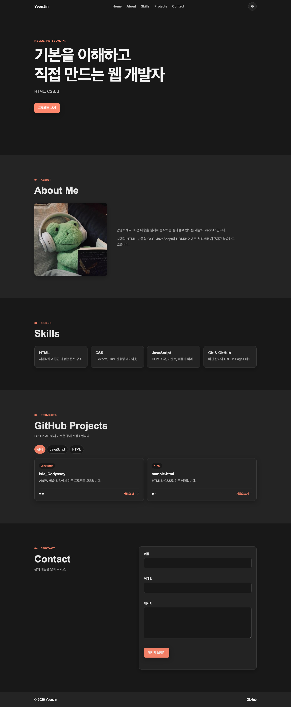

# YeonJin Portfolio

순수 HTML, CSS, JavaScript로 만든 반응형 자기소개 웹사이트입니다.
과제의 핵심인 **이벤트 → 상태 변경 → 화면 업데이트** 흐름을 직접 구현했습니다.

## 링크

- 배포: <https://islajin.github.io/Isla_Codyssey/>
- 코드: <https://github.com/Islajin/Isla_Codyssey/tree/main/B1_1>

## 화면

| 데스크톱 | 모바일 | 다크 모드 |
| --- | --- | --- |
|  |  |  |

## 구현 기능

- Hero, About, Skills, Projects, Contact, Footer 섹션
- 모바일 우선 반응형 레이아웃 (`768px`, `1024px`)
- 햄버거 메뉴와 부드러운 스크롤
- 스크롤 60px 이상에서 헤더 스타일 변경
- 스크롤 300px 이상에서 맨 위로 버튼 표시
- 다크 모드와 `localStorage` 설정 유지
- `IntersectionObserver` 스크롤 애니메이션 (`threshold: 0.2`)
- 문의 폼 필수값 및 이메일 형식 검사
- GitHub API 로딩·성공·오류·빈 상태 처리
- 프로젝트 언어 필터, Hero 타이핑 효과, 시스템 다크 모드 감지

## 핵심 구현 설명

### 1. HTML 구조

`header`, `nav`, `main`, `section`, `article`, `footer`를 사용해 각 영역의 역할이 드러나도록 구성했습니다. 프로필 이미지에는 `alt`를 작성했고, 모든 폼 `label`의 `for`와 입력 요소의 `id`를 연결했습니다.

### 2. Flexbox와 Grid

- 네비게이션은 항목을 가로 한 방향으로 배치하므로 Flexbox를 사용했습니다.
- 프로젝트 카드는 행과 열로 반복되므로 Grid를 사용했습니다.
- 프로젝트 Grid는 `repeat(auto-fit, minmax(...))`로 화면 너비에 따라 열 개수가 자동으로 바뀝니다.

### 3. DOM과 이벤트

`querySelector`로 요소를 선택하고 `addEventListener`로 `click`, `submit`, `scroll`, `input` 이벤트를 연결했습니다. HTML의 `onclick`은 사용하지 않았습니다.

```text
사용자 이벤트 → JavaScript 상태 변경 → 렌더 함수 실행 → DOM 변경
```

### 4. 다크 모드

```text
토글 클릭 → theme 상태 변경 → html[data-theme] 변경 → CSS 변수 교체
                                      └→ localStorage 저장
```

저장된 테마가 없으면 `prefers-color-scheme`으로 운영체제 설정을 감지합니다.

### 5. GitHub API

호출 주소:

```text
https://api.github.com/users/Islajin/repos
```

`fetch`와 `async/await`로 데이터를 가져오고 `try/catch`로 오류를 처리합니다.

```text
요청 시작 → loading → 로딩 문구
응답 성공 → success → 프로젝트 카드
결과 없음 → empty → "표시할 프로젝트가 없습니다"
요청 실패 → error → 오류 문구 + 다시 시도 버튼
```

- 구조분해 할당으로 저장소 속성을 꺼냅니다.
- `map()`과 템플릿 리터럴로 카드 HTML을 만듭니다.
- `filter()`로 선택한 언어의 프로젝트만 표시합니다.
- `forEach()`로 여러 DOM 요소에 이벤트를 연결합니다.
- 인증 없는 API의 호출 제한을 줄이기 위해 성공 결과를 10분간 캐시합니다.
- 403/429가 발생하면 명세대로 오류 상태와 다시 시도 버튼을 표시합니다.

### 6. 폼 검사

`input` 이벤트마다 현재 필드를 검사하고 입력란 가까이에 오류를 표시합니다. `submit`에서는 `event.preventDefault()`로 새로고침을 막고 전체 입력값을 다시 검사합니다. 검사를 통과하면 성공 메시지를 표시합니다.

### 7. 스크롤 애니메이션

`IntersectionObserver`가 `.reveal` 요소를 관찰합니다. 요소의 20%가 화면에 들어오면 `visible` 클래스를 추가하고 CSS transition이 실행됩니다.

## 상태 → 렌더링 예시

| 기능 | 이벤트 | 상태 | 화면 변경 |
| --- | --- | --- | --- |
| 다크 모드 | 버튼 클릭 | `theme` | CSS 변수 변경 |
| 햄버거 메뉴 | 버튼 클릭 | `menuOpen` | `active` 클래스 토글 |
| 프로젝트 | API 응답 | `status`, `items` | 상태 UI 또는 카드 렌더링 |
| 필터 | 언어 클릭 | `selectedLanguage` | 카드 목록 변경 |
| 폼 | 입력/제출 | `formErrors` | 오류 또는 성공 메시지 |

## 폴더 구조

```text
B1_1/
├── index.html
├── css/
│   └── style.css
├── js/
│   └── main.js
├── images/
│   └── favicon.svg
├── docs/
│   └── screenshots/
└── README.md
```

## 실행

VS Code에서 `B1_1/index.html`을 Live Server로 실행합니다.

외부 UI 프레임워크나 JavaScript 라이브러리는 사용하지 않았습니다.
