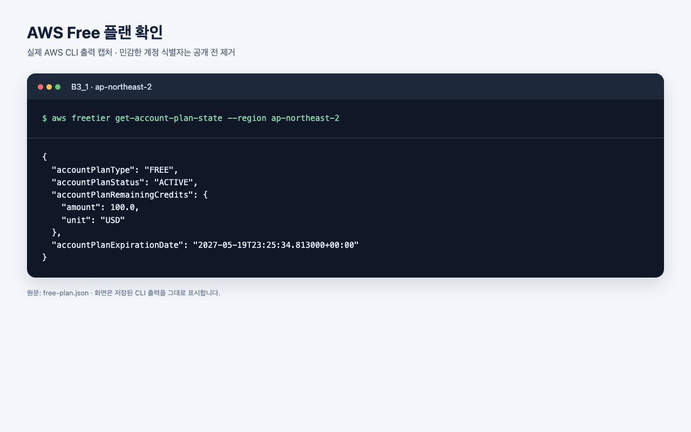
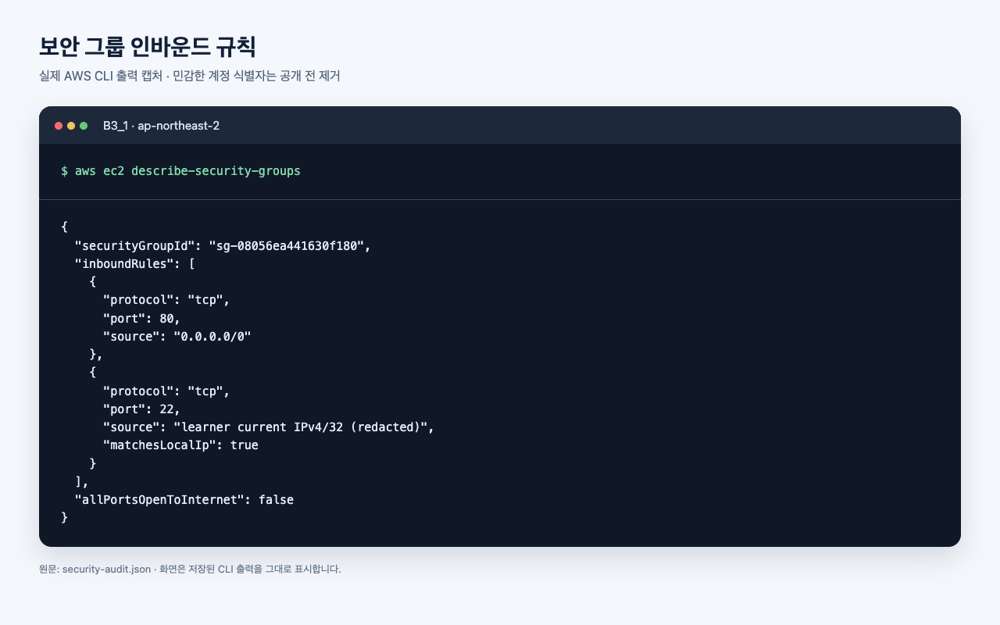
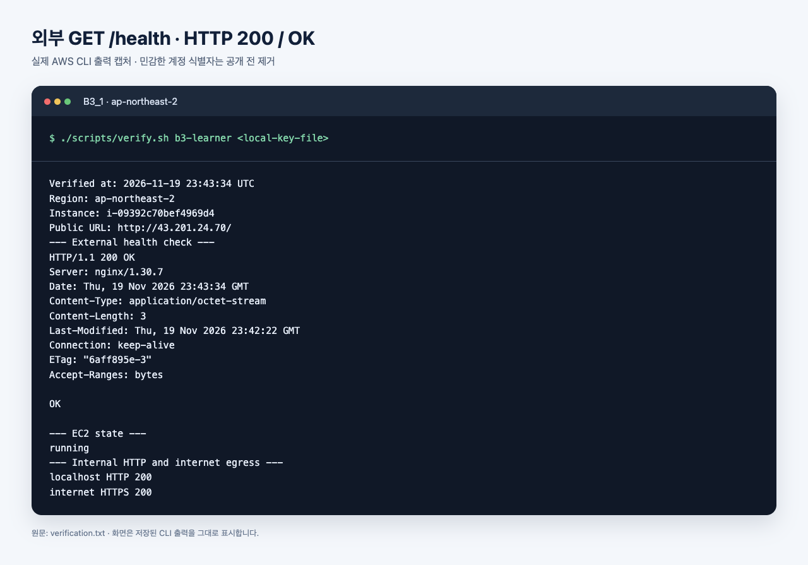
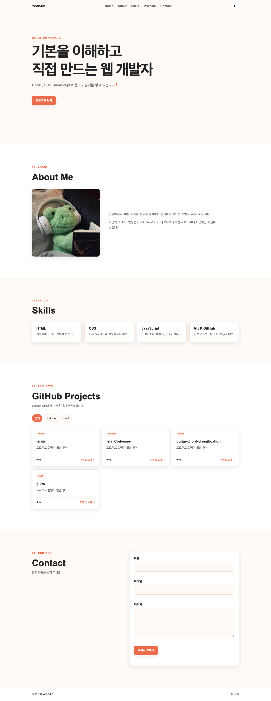

# B3_1 — 내 웹사이트를 인터넷에 올려 누구나 쓰게 하기

`B1_1` 포트폴리오를 **서울 리전(`ap-northeast-2`)**의 EC2와 Nginx에 배포하는 AWS 실습입니다. VPC, Public Subnet, Internet Gateway, Public Route Table, 보안 그룹, 최소 권한 IAM 사용자 정책을 코드로 정의했습니다.

> **실습 결과 (2026-11-20):** 새 AWS 계정의 전용 IAM 사용자 `B3_1Learner`로 서울 리전에 배포했습니다. 실제 구성과 외부 HTTP 응답을 검증하고 화면을 저장했습니다. 검증 뒤 과금 위험을 줄이기 위해 실습 리소스를 정리했습니다. 아래 URL은 **검증 당시 주소**이며 정리 후 접속할 수 없습니다.

## 제출 결과물

| 결과물 | 파일 | 설명 |
| --- | --- | --- |
| 아키텍처 다이어그램 | [`architecture.png`](docs/architecture.png) | VPC 안에 EC2를 두고 인터넷 사용자가 웹 서버에 접속하는 구성을 보여줍니다. |
| 외부 접속 증빙 | [`external-access.png`](docs/evidence/external-access.png), [`verification.txt`](docs/evidence/verification.txt) | 방식 B인 외부 `GET /health` 요청에서 HTTP 200과 본문 `OK`를 확인한 기록입니다. |
| 트러블슈팅 보고서 | [`troubleshooting.md`](docs/troubleshooting.md) | Nginx 시작 전 `reload` 오류의 증상·원인 확인·수정·재검증을 정리했습니다. |
| 리소스 정리 체크리스트 | [`cleanup-checklist.md`](docs/cleanup-checklist.md), [`cleanup.png`](docs/evidence/cleanup.png) | 검증 후 EC2 종료와 EBS·IGW·VPC 삭제, EIP 0개를 조회로 확인했습니다. |

네트워크·서버·보안·IAM의 추가 캡처와 설명은 [전체 진행과정](#전체-진행과정)에 있습니다. 평가 답변은 [`NOTION_SUBMISSION.md`](NOTION_SUBMISSION.md)에 정리했습니다.

이미지와 명령 출력은 **실제 AWS 조회·실제 외부 접속 결과**에서 만들었습니다. 계정 ID·개인 SSH IP·비밀 키는 공개하지 않습니다. AWS CLI 결과를 보기 좋게 렌더링한 이미지는 원본 JSON 또는 TXT를 함께 제공합니다.

## 외부 접속 검증 방식

**방식 B:** 외부 컴퓨터에서 `GET http://43.201.24.70/health`가 HTTP `200`과 본문 `OK`를 반환했습니다. 리소스 정리 후 URL은 더 이상 활성 상태가 아닙니다.

| 항목 | 실습 결과 |
| --- | --- |
| 리전 | `ap-northeast-2` (서울, 실제 배포·조회) |
| 검증 URL | `http://43.201.24.70/health` |
| 검증 시각 | 2026-11-19 23:43:34 UTC / 2026-11-20 08:43:34 KST |
| HTTP 응답 | `200 OK`, 본문 `OK` |
| 외부 화면 캡처 | [`external-access.png`](docs/evidence/external-access.png) |

## 설계

[아키텍처 다이어그램](docs/architecture.png)

| 구성 | 값과 역할 |
| --- | --- |
| VPC / Public Subnet | `10.0.0.0/16` / `10.0.1.0/24`, 하나씩 생성 |
| Internet Gateway | VPC에 연결해 인터넷 통신 경로 제공 |
| Public Route Table | `0.0.0.0/0 → IGW`, Public Subnet에 연결 |
| EC2 | `t3.micro`, Amazon Linux 2023, 공인 IPv4, Nginx, 암호화된 8 GiB gp3 EBS |
| Security Group 인바운드 | HTTP 80은 `0.0.0.0/0`, SSH 22는 현재 학습자 공인 IPv4 `/32`만 |
| IAM | 과제용 사용자 `B3_1Learner`에 서울 EC2/VPC·CloudFormation·공용 AMI 조회만 허용 |
| 과금 회피 | EIP·NAT Gateway·Load Balancer·RDS는 생성하지 않음; 검증 후 스택·볼륨 삭제 |

## 계정과 비용 확인

1. 서울 리전 접근이 가능한 **AWS 고급 가입(advanced) 계정** 또는 기존 일반 AWS 계정을 사용합니다. 새 방식의 프로젝트는 선택 리전이 제한될 수 있습니다. [AWS 가입 방식 비교](https://docs.aws.amazon.com/accounts/latest/reference/sign-up-for-aws.html)
2. 가입 화면에서 **Free account plan**이 제공되고 실제 선택되었는지, Billing에서 남은 크레딧·만료일을 확인합니다. 기존 AWS 고객은 Free 플랜 대상이 아닐 수 있습니다. Free 플랜은 사용 중 청구가 발생하지 않는다고 AWS가 안내하지만, 계정 상태를 직접 확인해야 합니다. [AWS Free 플랜](https://docs.aws.amazon.com/awsaccountbilling/latest/aboutv2/free-tier-plans.html)
3. 비용 알림을 위해 Zero spend budget을 설정합니다. **예산 알림은 과금 차단 장치가 아니므로** 아래 리소스 정리가 필수입니다. [AWS 예산 템플릿](https://docs.aws.amazon.com/cost-management/latest/userguide/budget-templates.html)
4. 신규 계정의 첫 IAM 사용자 생성은 계정 소유자의 **초기 설정**입니다. EC2 배포·검증·정리는 전용 비루트 IAM 사용자로만 수행합니다. 그 사용자에 `AdministratorAccess`를 연결하지 않습니다.
5. SSH 개인 키는 Git에 넣지 않습니다. EC2 Free Tier 대상 인스턴스와 AMI를 계정에서 확인합니다. [EC2 Free Tier 확인](https://docs.aws.amazon.com/AWSEC2/latest/UserGuide/ec2-free-tier-usage.html)

## 재현 방법

아래 명령은 `B3_1` 디렉터리에서 실행합니다. 먼저 계정 소유자가 같은 계정 안에 `B3_1Learner` IAM 사용자 1명을 만들고 [`infrastructure/iam/learner-permissions.json`](infrastructure/iam/learner-permissions.json)을 인라인 정책으로 연결합니다. 콘솔 암호를 설정한 뒤 이 사용자의 계정 ID·이름·암호로 로그인합니다. 실제 인프라 배포는 해당 사용자 프로필로만 합니다. 별도 CloudFormation 서비스 역할 방식은 [`scripts/bootstrap-iam.sh`](scripts/bootstrap-iam.sh)와 [`scripts/bootstrap-operator.sh`](scripts/bootstrap-operator.sh)에 선택적으로 남겨 두었습니다.

```bash
aws login --profile b3-learner --region ap-northeast-2
aws sts get-caller-identity --profile b3-learner

# EC2 키페어는 서울 리전에 한 개 만들고 개인 키를 Git 밖에 보관한다.
./scripts/deploy.sh --profile b3-learner \
  --key-name B3_1-KEY --key-file /안전한/경로/B3_1-KEY.pem \
  --ssh-cidr MY_PUBLIC_IPV4/32

./scripts/verify.sh b3-learner /안전한/경로/B3_1-KEY.pem
```

CloudFormation은 [`infrastructure/cloudformation.yaml`](infrastructure/cloudformation.yaml)에 정의되어 있습니다. 배포 스크립트는 Nginx 문서 루트에 [`site/`](site/)를 복사하고 `/health` 응답을 확인합니다. 검증 스크립트는 외부 `/health`, 인스턴스 내부 `curl http://localhost`, 아웃바운드 `curl https://example.com`을 실행합니다.

## 실습 종료 후 정리

외부 접속 및 구성 캡처를 저장한 다음 실행합니다.

```bash
./scripts/cleanup.sh b3-learner
```

CloudFormation 삭제 완료를 기다리고 EC2, EBS, Elastic IP, IGW, Subnet, Route Table, SG, VPC를 조회해 [`docs/cleanup-checklist.md`](docs/cleanup-checklist.md)에 실제 ID와 결과를 적습니다. 생성했다면 EC2 키페어도 삭제합니다. IAM 사용자는 과제 제출·감사에 필요한 기간이 지나면 계정 관리자가 삭제합니다. 이 프로젝트와 무관한 계정 리소스는 건드리지 않습니다.

## 전체 진행과정

### 1. 계정과 작업 권한을 준비했습니다

먼저 새 AWS 계정의 Free 플랜이 활성 상태인지 확인했습니다. 실습 인프라는 모두 **서울 리전(`ap-northeast-2`)**에 만들기로 정했습니다. Free 플랜 조회는 실습 당시의 계정 상태를 보여주며, 최종 청구액을 확인한 화면은 아닙니다.



AWS 설정을 변경할 때는 실습용 IAM 사용자 `B3_1Learner`를 사용했습니다. 처음 이 사용자를 만드는 계정 설정에는 루트 계정을 썼지만, VPC와 EC2를 배포·검증·삭제하는 작업은 이 비루트 사용자로 진행했습니다. IAM은 **AWS 리소스를 만들고 삭제할 권한**을 정합니다. 사용자에게 서울 리전의 EC2·VPC·CloudFormation 작업을 허용했고, `AdministratorAccess` 관리형 정책은 연결하지 않았습니다. 정책 일부에는 `Resource: "*"`가 있으므로 모든 리소스를 개별 ID로 제한한 것은 아닙니다.


### 2. 서버가 놓일 네트워크를 만들었습니다

VPC는 AWS 안에서 정한 **내 네트워크 범위**입니다. 이번에는 `10.0.0.0/16` VPC 안에 `10.0.1.0/24` Public Subnet을 만들었습니다. `/16`과 `/24`는 IP 주소 범위의 크기를 나타내며, 서브넷은 VPC보다 작은 범위입니다. EC2는 이 Public Subnet에 배치했습니다.

인터넷과 통신할 수 있도록 Internet Gateway(IGW)를 VPC에 연결했습니다. Public Subnet에 연결된 Route Table에는 `0.0.0.0/0 → IGW`를 넣었습니다. 이는 **VPC 밖의 일반 IPv4 목적지로 가는 트래픽을 IGW로 보내라**는 뜻입니다. 서브넷 이름만 Public이라고 해서 인터넷이 열리는 것은 아닙니다. IGW 연결과 라우트, EC2 공인 IP가 함께 필요합니다.


아래 조회 결과에서 서울 리전, VPC·서브넷 주소 범위, IGW의 VPC 연결, 활성화된 기본 경로, 서브넷과 Route Table의 연결을 확인했습니다. 그림은 설계이고, 이 조회 결과는 **실제로 생성된 구성**의 기록입니다.


### 3. 웹 접속과 관리 접속을 구분했습니다

보안 그룹(SG)은 EC2에 적용하는 **네트워크 접속 규칙**입니다. 방문자가 웹사이트를 볼 수 있도록 HTTP의 TCP 80번은 모든 IPv4 주소(`0.0.0.0/0`)에서 허용했습니다. 서버에 원격으로 명령을 입력하는 SSH의 TCP 22번은 학습자의 공인 IP 한 개(`/32`)로 제한했습니다. DB는 만들지 않았고 DB 포트나 전체 포트 공개 규칙도 추가하지 않았습니다. SSH를 전 세계에 열면 누구나 로그인 시도를 할 수 있기 때문입니다.

SG와 IAM의 차이는 제어 대상입니다. **SG는 EC2로 들어오는 IP와 포트를**, **IAM은 AWS에서 EC2·VPC를 생성·삭제하는 사용자의 권한을** 제어합니다. 같은 `0.0.0.0/0`도 Route Table에서는 목적지 범위, SG에서는 접속 출발지 범위라는 점을 구분했습니다.



### 4. EC2에 웹 서버와 사이트를 배포했습니다

EC2는 AWS에서 빌려 쓰는 가상 컴퓨터입니다. Public Subnet에 `t3.micro` 한 대를 만들고 Amazon Linux 2023에서 Nginx를 실행했습니다. EC2의 공인 IP는 외부 사용자가 서버를 찾는 주소이고, **EBS는 운영체제와 사이트 파일을 저장하는 디스크**입니다. 이번 EBS는 암호화된 8GiB `gp3`였고 EC2 종료 시 삭제되도록 설정했습니다.


EC2가 처음 켜질 때 User Data가 Nginx를 설치하고 `/health` 파일에 `OK`를 기록했습니다. 이후 SSH로 EC2에 접속해 포트폴리오 파일을 Nginx의 웹 디렉터리에 복사했습니다. SSH는 내 컴퓨터에서 원격 EC2에 안전하게 명령을 실행하는 방식이고, 접속에는 개인 키 파일을 사용했습니다. 개인 키는 GitHub에 올리지 않았습니다.

### 5. 배포 오류를 확인하고 수정했습니다

첫 배포에서는 EC2가 생성됐지만 Nginx 시작이 끝나기 전에 배포 스크립트가 `reload`를 실행해 실패했습니다. 원인을 단정하지 않고 SSH로 서버 로그를 확인했습니다. `journalctl`의 `Unit cannot be reloaded because it is inactive`를 보고 **Nginx가 아직 실행 중이 아니었다**는 가설을 확인했습니다. 스크립트가 Nginx 활성 상태와 `/health` 파일 생성을 기다리도록 바꾸고 재실행해 성공했습니다. 이 과정을 [트러블슈팅 보고서](docs/troubleshooting.md)에 증상→가설→검증→조치→결과→재발 방지 순서로 남겼습니다.

### 6. 안과 밖에서 각각 동작을 확인했습니다

EC2 **안에서** `curl http://localhost/`는 HTTP 200을 반환했고, EC2에서 **밖으로** 보낸 `curl https://example.com`도 HTTP 200이었습니다. 이 두 결과는 Nginx와 아웃바운드 통신 확인입니다. 외부 사용자가 우리 서버에 접속할 수 있는지는 별도로 검사해야 합니다.


그래서 외부 접속 검증은 **방식 B**를 선택했습니다. 배포 당시 공인 IP `43.201.24.70`의 `/health`에 GET 요청을 보내 `HTTP/1.1 200 OK`와 응답 본문 `OK`를 확인했습니다. 상태 코드 `200`은 요청 성공, 본문의 `OK`는 Nginx가 보낸 고정 문구입니다. `/health`를 택하면 페이지 디자인과 관계없이 서버가 응답하는지 확인하기 쉽습니다. `server-verification.png`와 아래 `external-access.png`는 **같은 검증 기록을 보여주는 이미지**입니다.



아래 포트폴리오 사진은 배포한 **같은 소스를 로컬에서 렌더링한 화면 참고 자료**입니다. AWS 외부 접속의 증거로 사용한 사진은 위 `/health` 응답입니다.



### 7. 증빙을 저장한 뒤 리소스를 정리했습니다

CloudFormation의 `b3-1` 스택과 `Project=B3_1` 태그, 생성 당시 리소스 ID로 실습 대상을 추적했습니다. 접속·구성 사진을 먼저 저장한 다음 스택 삭제 완료를 기다렸습니다. 재조회 결과 EC2는 `terminated`, EBS·IGW·Subnet·Route Table·SG·VPC는 `not found`였습니다. 별도 Elastic IP(EIP)는 만들지 않아 할당 0개였고, 스택 밖에서 만든 EC2 키페어도 삭제했습니다. EIP가 없었다는 말은 EC2에 자동 할당 공인 IP가 없었다는 뜻은 아닙니다.


정리 상태는 [체크리스트](docs/cleanup-checklist.md)에 기록했습니다. 서버를 삭제했으므로 검증 당시 URL은 지금 열리지 않습니다. IAM 사용자·액세스 키는 스택 밖의 계정 관리 항목으로 남아 있고, 이 IAM 사용자 권한으로는 Billing의 최종 청구액 화면을 확인하지 못했습니다.

---

## 평가 문항 요약과 증빙

### 항목 1. 실제 구성과 동작

- **네트워크:** 서울 리전에 VPC와 Public Subnet을 만들고, Internet Gateway와 기본 경로(`0.0.0.0/0 → IGW`)를 연결했습니다.
- **서버:** Public Subnet의 EC2 한 대에서 Nginx를 실행했습니다. SSH로 접속해 파일을 배포했고, EC2 내부 `localhost` 요청에서 HTTP 200을 확인했습니다.
- **접근 제한:** HTTP 80은 누구나 접속할 수 있고, SSH 22는 학습자 공인 IP 한 개(`/32`)에서만 접속할 수 있게 했습니다.
- **외부 검증:** 방식 B를 선택해 `GET http://43.201.24.70/health`에서 HTTP 200과 본문 `OK`를 확인했습니다. 이 주소는 리소스 삭제 후 비활성 상태입니다.
- **정리:** 검증 후 EC2를 종료하고 EBS·IGW·VPC 등 실습 리소스 삭제를 조회로 확인했습니다. EIP는 생성하지 않았습니다.

### 항목 2. 구성한 이유

- **통신 흐름:** 외부 요청은 EC2의 공인 IP로 들어오고, VPC의 IGW·Public Subnet 연결과 보안 그룹의 80번 허용을 거쳐 Nginx가 응답합니다.
- **포트 최소화:** 방문자에게는 HTTP 80만, 관리자에게는 지정된 IP의 SSH 22만 필요했습니다. DB 포트와 전체 포트 공개 규칙은 만들지 않았습니다.
- **방식 B 선택:** `/health`는 화면 디자인과 관계없이 상태 코드와 고정 응답을 확인할 수 있어 외부 접속 증빙에 적합합니다.
- **리소스 추적:** `b3-1` 스택, `Project=B3_1` 태그, 리소스 ID와 정리 체크리스트로 생성·삭제 대상을 구별했습니다.

### 항목 3. 핵심 개념과 보안

- **기본 경로:** Public Subnet의 `0.0.0.0/0 → IGW`는 인터넷으로 향하는 트래픽의 경로입니다. EC2 공인 IP와 보안 그룹 허용도 함께 필요합니다.
- **SG와 IAM:** SG는 EC2의 IP·포트 접속을, IAM은 AWS 리소스 생성·삭제 같은 API 작업을 제어합니다. 실습 IAM 사용자에게 `AdministratorAccess`는 연결하지 않았습니다.
- **관리 포트 보호:** SSH나 DB 포트를 전 세계에 열면 누구나 접속을 시도할 수 있습니다. SSH는 학습자 IP `/32`로 제한했고 DB는 생성하지 않았습니다.
- **문제 해결:** Nginx가 시작되기 전에 `reload`가 실행되어 실패했습니다. 로그로 원인을 확인하고 서비스가 준비될 때까지 기다리도록 수정한 뒤 다시 검증했습니다. [트러블슈팅 기록](docs/troubleshooting.md)

### 항목 4. 상황별 대응

아래는 실제로 모두 발생한 장애가 아닌 **평가 질문에 대한 대응 방법**입니다.

- **외부 접속 실패:** 라우트·IGW 연결 → SG 80번 → 공인 IP/DNS → EC2의 Nginx와 로그 순서로 확인합니다.
- **IAM 권한 부족:** 거부된 API 작업과 사용자·리전을 확인하고, 필요한 작업 권한만 추가합니다.
- **EC2 두 대로 확장:** 같은 앱을 두 서버에 배포하고 ALB·헬스 체크로 요청을 분산하는 구성을 고려합니다. 이번 실습에는 만들지 않았습니다.
- **예상 밖 비용:** Billing에서 서비스·리전을 확인하고 EC2, EBS, 공인 IPv4/EIP 등을 추적합니다. 이번에는 리소스를 정리했지만 Billing 최종 청구 화면은 확인하지 못했습니다.
