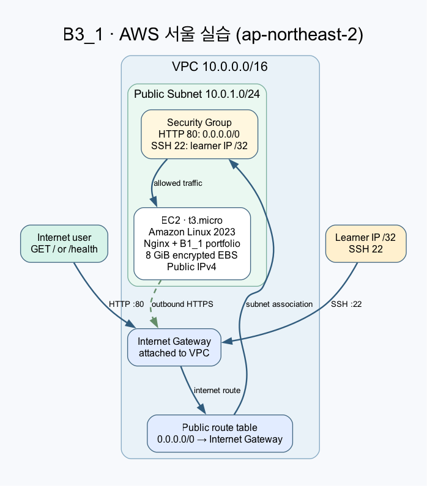
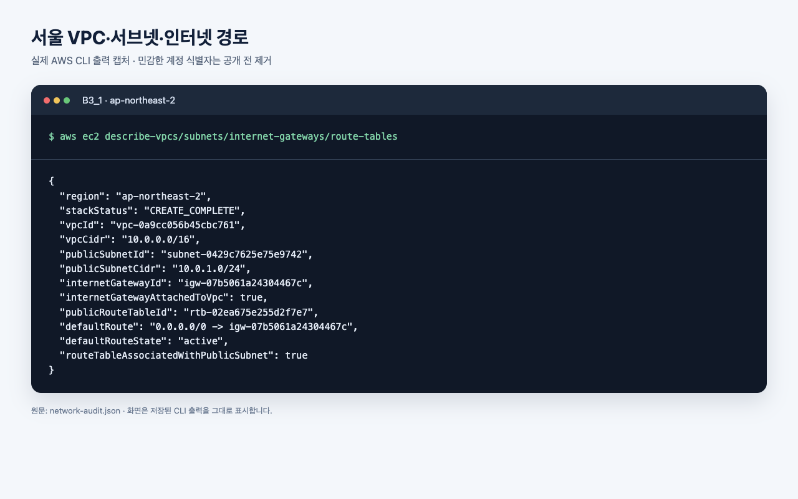
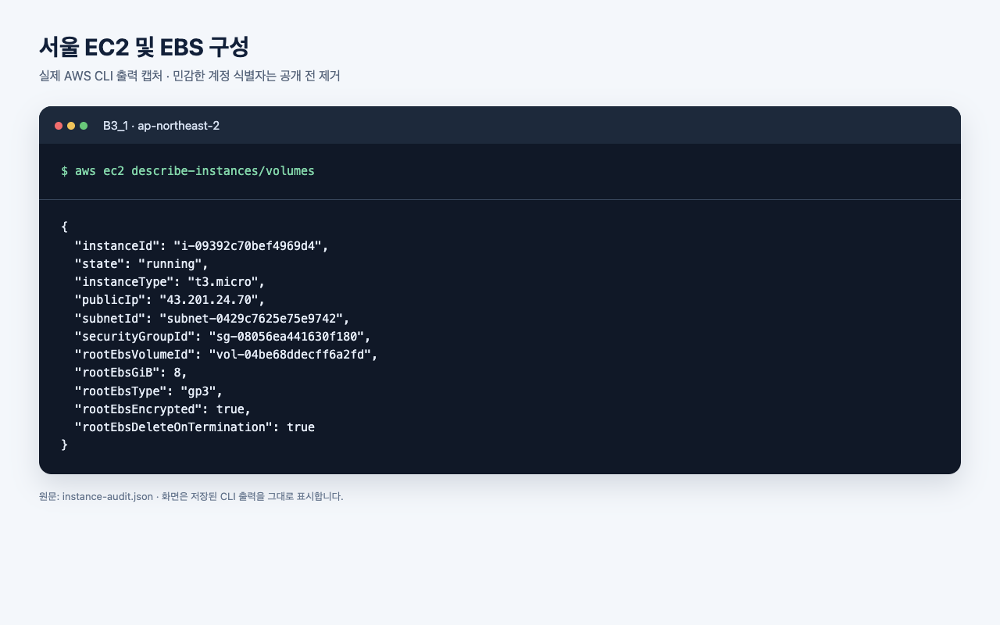
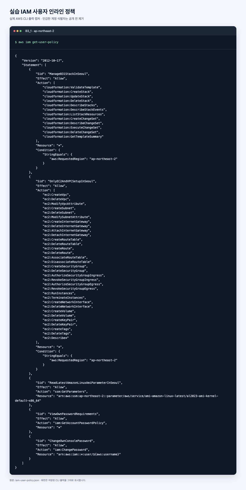

# B3_1 — 내 웹사이트를 인터넷에 올려 누구나 쓰게 하기

`B1_1` 포트폴리오를 **서울 리전(`ap-northeast-2`)**의 EC2와 Nginx에 배포하는 AWS 실습입니다. VPC, Public Subnet, Internet Gateway, Public Route Table, 보안 그룹, 최소 권한 IAM 사용자 정책을 코드로 정의했습니다.

> **실습 결과 (2026-11-20):** 새 AWS 계정의 전용 IAM 사용자 `B3_1Learner`로 서울 리전에 배포했습니다. 실제 구성과 외부 HTTP 응답을 검증하고 화면을 저장했습니다. 검증 뒤 과금 위험을 줄이기 위해 실습 리소스를 정리했습니다. 아래 URL은 **검증 당시 주소**이며 정리 후 접속할 수 없습니다.

## 제출 결과물과 캡처

| 요구사항 | 제출 파일 | 현재 상태 |
| --- | --- | --- |
| 아키텍처 다이어그램 | [`docs/architecture.png`](docs/architecture.png) | 실제 서울 VPC·Subnet·IGW·Route Table·EC2·SG 구성과 대조 |
| 외부 접속 방식 B, `GET /health` HTTP 200과 `OK` | [`external-access.png`](docs/evidence/external-access.png), [`verification.txt`](docs/evidence/verification.txt) | 외부에서 HTTP 200 / `OK` 확인 |
| 포트폴리오 화면 참고 | [`site-preview.png`](docs/evidence/site-preview.png) | 배포한 동일 소스의 로컬 미리보기. 외부 접속 증빙은 위 `/health` 결과 |
| VPC·Subnet·IGW·기본 경로 확인 | [`network.png`](docs/evidence/network.png), [`network-audit.json`](docs/evidence/network-audit.json) | 실제 AWS 리소스 조회 통과 |
| EC2·Nginx·로컬 HTTP·아웃바운드 확인 | [`instance-and-server.png`](docs/evidence/instance-and-server.png), [`verification.txt`](docs/evidence/verification.txt) | 실행 상태와 내부·외부 응답 확인 |
| SG HTTP 80 공개·SSH 22 개인 IP 제한 | [`security-group.png`](docs/evidence/security-group.png), [`security-audit.json`](docs/evidence/security-audit.json) | 두 인바운드 규칙 확인 |
| IAM 최소 권한 | [`iam.png`](docs/evidence/iam.png), [`docs/iam-plan.md`](docs/iam-plan.md) | 비루트 IAM 사용자 정책과 관리자 정책 미연결 확인 |
| 오류 재현·분석·해결 | [`docs/troubleshooting.md`](docs/troubleshooting.md) | Nginx 준비 전 reload 오류 분석·해결 |
| EC2·EBS·EIP·IGW·VPC 정리 | [`docs/cleanup-checklist.md`](docs/cleanup-checklist.md), [`cleanup.png`](docs/evidence/cleanup.png) | 스택 삭제 후 실제 조회 결과 기록 |
| 평가 문항용 노션 원고 | [`NOTION_SUBMISSION.md`](NOTION_SUBMISSION.md) | 실제 서울 실습 결과 반영 |

이미지와 명령 출력은 **실제 AWS 조회·실제 외부 접속 결과**에서 만들었습니다. 계정 ID·개인 SSH IP·비밀 키는 공개하지 않습니다. AWS CLI 결과를 보기 좋게 렌더링한 이미지는 원본 JSON 또는 TXT를 함께 제공합니다.

## 외부 접속 검증 방식

**방식 B:** 외부 컴퓨터에서 `GET http://43.201.24.70/health`가 HTTP `200`과 본문 `OK`를 반환했습니다. 리소스 정리 후 URL은 더 이상 활성 상태가 아닙니다.

| 항목 | 실습 결과 |
| --- | --- |
| 리전 | `ap-northeast-2` (서울, 실제 배포·조회) |
| 검증 URL | `http://43.201.24.70/health` |
| 검증 시각 | 2026-11-19 23:43:34 UTC / 2026-11-20 08:43:34 KST |
| HTTP 응답 | `200 OK`, 본문 `OK` |
| 외부 화면 캡처 | [`external-access.png`](docs/evidence/external-access.png) |

## 진행 과정과 확인한 내용

1. 새 AWS 계정의 Free 플랜 상태와 서울 리전 사용 가능 여부를 확인했습니다. [`free-plan.png`](docs/evidence/free-plan.png)에 계정 ID를 가린 조회 결과를 남겼습니다.
2. 별도 IAM 사용자 `B3_1Learner`에 과제에 필요한 EC2/VPC·CloudFormation 권한을 연결했습니다. 관리형 정책 연결 목록이 비어 있고 인라인 정책에 `AdministratorAccess`가 없음을 [정책 캡처](docs/evidence/iam.png)와 [원본](docs/evidence/iam-attached-policies.json)으로 확인했습니다.
3. 서울 리전에 VPC, Public Subnet, Internet Gateway, 기본 라우트, 보안 그룹, EC2 한 대를 생성했습니다. [네트워크](docs/evidence/network.png)와 [보안 그룹](docs/evidence/security-group.png) 캡처의 리소스 ID를 실제 조회 결과와 대조했습니다.
4. 처음 배포할 때 EC2의 Nginx 준비가 끝나기 전에 reload가 실행돼 실패했습니다. 로그를 확인하고 서비스 활성 상태를 기다리도록 스크립트를 고친 뒤 재실행했습니다. 자세한 과정은 [트러블슈팅 보고서](docs/troubleshooting.md)에 있습니다.
5. SSH로 접속해 Nginx와 `localhost` HTTP 200, 외부 HTTPS 아웃바운드 200을 확인했습니다. 외부에서는 `/health`의 HTTP 200·`OK`를 캡처했습니다. 포트폴리오 전체 화면은 배포한 소스를 로컬에서 다시 렌더링한 참고 이미지이며, 외부 접속 증빙과 구분합니다. [서버 검증 캡처](docs/evidence/server-verification.png)를 함께 봐 주세요.
6. 캡처를 저장한 뒤 스택을 삭제했습니다. EC2 종료, EBS·네트워크 리소스 삭제, EIP 0개를 [정리 캡처](docs/evidence/cleanup.png)와 [체크리스트](docs/cleanup-checklist.md)에 남겼습니다.

## 설계

[아키텍처 다이어그램](docs/architecture.png)

| 구성 | 값과 역할 |
| --- | --- |
| VPC / Public Subnet | `10.0.0.0/16` / `10.0.1.0/24`, 하나씩 생성 |
| Internet Gateway | VPC에 연결해 인터넷 통신 경로 제공 |
| Public Route Table | `0.0.0.0/0 → IGW`, Public Subnet에 연결 |
| EC2 | `t3.micro`, Amazon Linux 2023, 공인 IPv4, Nginx, 암호화된 8 GiB gp3 EBS |
| Security Group 인바운드 | HTTP 80은 `0.0.0.0/0`, SSH 22는 현재 학습자 공인 IPv4 `/32`만 |
| IAM | 과제용 사용자 `B3_1Learner`에 서울 EC2/VPC·CloudFormation·공용 AMI 조회만 허용 |
| 과금 회피 | EIP·NAT Gateway·Load Balancer·RDS는 생성하지 않음; 검증 후 스택·볼륨 삭제 |

## 계정과 비용 확인

1. 서울 리전 접근이 가능한 **AWS 고급 가입(advanced) 계정** 또는 기존 일반 AWS 계정을 사용합니다. 새 방식의 프로젝트는 선택 리전이 제한될 수 있습니다. [AWS 가입 방식 비교](https://docs.aws.amazon.com/accounts/latest/reference/sign-up-for-aws.html)
2. 가입 화면에서 **Free account plan**이 제공되고 실제 선택되었는지, Billing에서 남은 크레딧·만료일을 확인합니다. 기존 AWS 고객은 Free 플랜 대상이 아닐 수 있습니다. Free 플랜은 사용 중 청구가 발생하지 않는다고 AWS가 안내하지만, 계정 상태를 직접 확인해야 합니다. [AWS Free 플랜](https://docs.aws.amazon.com/awsaccountbilling/latest/aboutv2/free-tier-plans.html)
3. 비용 알림을 위해 Zero spend budget을 설정합니다. **예산 알림은 과금 차단 장치가 아니므로** 아래 리소스 정리가 필수입니다. [AWS 예산 템플릿](https://docs.aws.amazon.com/cost-management/latest/userguide/budget-templates.html)
4. 신규 계정의 첫 IAM 사용자 생성은 계정 소유자의 **초기 설정**입니다. EC2 배포·검증·정리는 전용 비루트 IAM 사용자로만 수행합니다. 그 사용자에 `AdministratorAccess`를 연결하지 않습니다.
5. SSH 개인 키는 Git에 넣지 않습니다. EC2 Free Tier 대상 인스턴스와 AMI를 계정에서 확인합니다. [EC2 Free Tier 확인](https://docs.aws.amazon.com/AWSEC2/latest/UserGuide/ec2-free-tier-usage.html)

## 재현 방법

아래 명령은 `B3_1` 디렉터리에서 실행합니다. 먼저 계정 소유자가 같은 계정 안에 `B3_1Learner` IAM 사용자 1명을 만들고 [`infrastructure/iam/learner-permissions.json`](infrastructure/iam/learner-permissions.json)을 인라인 정책으로 연결합니다. 콘솔 암호를 설정한 뒤 이 사용자의 계정 ID·이름·암호로 로그인합니다. 실제 인프라 배포는 해당 사용자 프로필로만 합니다. 별도 CloudFormation 서비스 역할 방식은 [`scripts/bootstrap-iam.sh`](scripts/bootstrap-iam.sh)와 [`scripts/bootstrap-operator.sh`](scripts/bootstrap-operator.sh)에 선택적으로 남겨 두었습니다.

```bash
aws login --profile b3-learner --region ap-northeast-2
aws sts get-caller-identity --profile b3-learner

# EC2 키페어는 서울 리전에 한 개 만들고 개인 키를 Git 밖에 보관한다.
./scripts/deploy.sh --profile b3-learner \
  --key-name B3_1-KEY --key-file /안전한/경로/B3_1-KEY.pem \
  --ssh-cidr MY_PUBLIC_IPV4/32

./scripts/verify.sh b3-learner /안전한/경로/B3_1-KEY.pem
```

CloudFormation은 [`infrastructure/cloudformation.yaml`](infrastructure/cloudformation.yaml)에 정의되어 있습니다. 배포 스크립트는 Nginx 문서 루트에 [`site/`](site/)를 복사하고 `/health` 응답을 확인합니다. 검증 스크립트는 외부 `/health`, 인스턴스 내부 `curl http://localhost`, 아웃바운드 `curl https://example.com`을 실행합니다.

## 실습 종료 후 정리

외부 접속 및 구성 캡처를 저장한 다음 실행합니다.

```bash
./scripts/cleanup.sh b3-learner
```

CloudFormation 삭제 완료를 기다리고 EC2, EBS, Elastic IP, IGW, Subnet, Route Table, SG, VPC를 조회해 [`docs/cleanup-checklist.md`](docs/cleanup-checklist.md)에 실제 ID와 결과를 적습니다. 생성했다면 EC2 키페어도 삭제합니다. IAM 사용자는 과제 제출·감사에 필요한 기간이 지나면 계정 관리자가 삭제합니다. 이 프로젝트와 무관한 계정 리소스는 건드리지 않습니다.

---

## 평가 문항 요약과 증빙

### 항목 1. 실제 구성과 동작

- **네트워크:** 서울 리전에 VPC와 Public Subnet을 만들고, Internet Gateway와 기본 경로(`0.0.0.0/0 → IGW`)를 연결했습니다.
- **서버:** Public Subnet의 EC2 한 대에서 Nginx를 실행했습니다. SSH로 접속해 파일을 배포했고, EC2 내부 `localhost` 요청에서 HTTP 200을 확인했습니다.
- **접근 제한:** HTTP 80은 누구나 접속할 수 있고, SSH 22는 학습자 공인 IP 한 개(`/32`)에서만 접속할 수 있게 했습니다.
- **외부 검증:** 방식 B를 선택해 `GET http://43.201.24.70/health`에서 HTTP 200과 본문 `OK`를 확인했습니다. 이 주소는 리소스 삭제 후 비활성 상태입니다.
- **정리:** 검증 후 EC2를 종료하고 EBS·IGW·VPC 등 실습 리소스 삭제를 조회로 확인했습니다. EIP는 생성하지 않았습니다.

### 항목 2. 구성한 이유

- **통신 흐름:** 외부 요청은 EC2의 공인 IP로 들어오고, VPC의 IGW·Public Subnet 연결과 보안 그룹의 80번 허용을 거쳐 Nginx가 응답합니다.
- **포트 최소화:** 방문자에게는 HTTP 80만, 관리자에게는 지정된 IP의 SSH 22만 필요했습니다. DB 포트와 전체 포트 공개 규칙은 만들지 않았습니다.
- **방식 B 선택:** `/health`는 화면 디자인과 관계없이 상태 코드와 고정 응답을 확인할 수 있어 외부 접속 증빙에 적합합니다.
- **리소스 추적:** `b3-1` 스택, `Project=B3_1` 태그, 리소스 ID와 정리 체크리스트로 생성·삭제 대상을 구별했습니다.

### 항목 3. 핵심 개념과 보안

- **기본 경로:** Public Subnet의 `0.0.0.0/0 → IGW`는 인터넷으로 향하는 트래픽의 경로입니다. EC2 공인 IP와 보안 그룹 허용도 함께 필요합니다.
- **SG와 IAM:** SG는 EC2의 IP·포트 접속을, IAM은 AWS 리소스 생성·삭제 같은 API 작업을 제어합니다. 실습 IAM 사용자에게 `AdministratorAccess`는 연결하지 않았습니다.
- **관리 포트 보호:** SSH나 DB 포트를 전 세계에 열면 누구나 접속을 시도할 수 있습니다. SSH는 학습자 IP `/32`로 제한했고 DB는 생성하지 않았습니다.
- **문제 해결:** Nginx가 시작되기 전에 `reload`가 실행되어 실패했습니다. 로그로 원인을 확인하고 서비스가 준비될 때까지 기다리도록 수정한 뒤 다시 검증했습니다. [트러블슈팅 기록](docs/troubleshooting.md)

### 항목 4. 상황별 대응

아래는 실제로 모두 발생한 장애가 아닌 **평가 질문에 대한 대응 방법**입니다.

- **외부 접속 실패:** 라우트·IGW 연결 → SG 80번 → 공인 IP/DNS → EC2의 Nginx와 로그 순서로 확인합니다.
- **IAM 권한 부족:** 거부된 API 작업과 사용자·리전을 확인하고, 필요한 작업 권한만 추가합니다.
- **EC2 두 대로 확장:** 같은 앱을 두 서버에 배포하고 ALB·헬스 체크로 요청을 분산하는 구성을 고려합니다. 이번 실습에는 만들지 않았습니다.
- **예상 밖 비용:** Billing에서 서비스·리전을 확인하고 EC2, EBS, 공인 IPv4/EIP 등을 추적합니다. 이번에는 리소스를 정리했지만 Billing 최종 청구 화면은 확인하지 못했습니다.

### 사진 모아보기

아래 사진은 설명에 쓰인 실제 조회·검증 결과입니다. AWS CLI 출력을 보기 좋게 표시한 사진에는 원본 JSON·TXT를 함께 보관했습니다. 포트폴리오 이미지는 **로컬 미리보기**이며 외부 접속 증빙은 `/health` 응답입니다.

<details>
<summary>네트워크: 아키텍처와 실제 VPC·라우트 조회</summary>





</details>

<details>
<summary>서버와 외부 접속: EC2·EBS, 내부·외부 HTTP, 포트폴리오 참고</summary>




</details>

<details>
<summary>보안: 보안 그룹 규칙과 IAM 정책</summary>




</details>

<details>
<summary>비용과 정리: Free 플랜 상태와 삭제 결과</summary>


</details>
