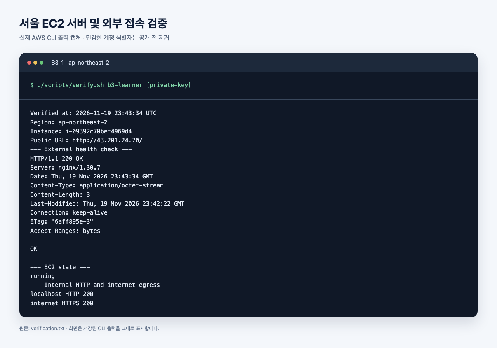
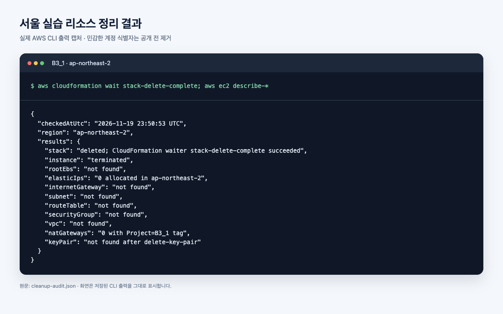

# B3_1 — 내 웹사이트를 인터넷에 올려 누구나 쓰게 하기

`B1_1` 포트폴리오를 **서울 리전(`ap-northeast-2`)**의 EC2와 Nginx에 배포하는 AWS 실습입니다. VPC, Public Subnet, Internet Gateway, Public Route Table, 보안 그룹, 최소 권한 IAM 사용자 정책을 코드로 정의했습니다.

> **실습 결과 (2026-11-20):** 새 AWS 계정의 전용 IAM 사용자 `B3_1Learner`로 서울 리전에 배포했습니다. 실제 구성과 외부 HTTP 응답을 검증하고 화면을 저장했습니다. 검증 뒤 과금 위험을 줄이기 위해 실습 리소스를 정리했습니다. 아래 URL은 **검증 당시 주소**이며 정리 후 접속할 수 없습니다.

## 제출 결과물과 캡처

| 요구사항 | 제출 파일 | 현재 상태 |
| --- | --- | --- |
| 아키텍처 다이어그램 | [`docs/architecture.png`](docs/architecture.png) | 실제 서울 VPC·Subnet·IGW·Route Table·EC2·SG 구성과 대조 |
| 외부 접속 방식 B, `GET /health` HTTP 200과 `OK` | [`external-access.png`](docs/evidence/external-access.png), [`verification.txt`](docs/evidence/verification.txt) | 외부에서 HTTP 200 / `OK` 확인 |
| 포트폴리오 화면 참고 | [`site-preview.png`](docs/evidence/site-preview.png) | 배포한 동일 소스의 로컬 미리보기. 외부 접속 증빙은 위 `/health` 결과 |
| VPC·Subnet·IGW·기본 경로 확인 | [`network.png`](docs/evidence/network.png), [`network-audit.json`](docs/evidence/network-audit.json) | 실제 AWS 리소스 조회 통과 |
| EC2·Nginx·로컬 HTTP·아웃바운드 확인 | [`instance-and-server.png`](docs/evidence/instance-and-server.png), [`verification.txt`](docs/evidence/verification.txt) | 실행 상태와 내부·외부 응답 확인 |
| SG HTTP 80 공개·SSH 22 개인 IP 제한 | [`security-group.png`](docs/evidence/security-group.png), [`security-audit.json`](docs/evidence/security-audit.json) | 두 인바운드 규칙 확인 |
| IAM 최소 권한 | [`iam.png`](docs/evidence/iam.png), [`docs/iam-plan.md`](docs/iam-plan.md) | 비루트 IAM 사용자 정책과 관리자 정책 미연결 확인 |
| 오류 재현·분석·해결 | [`docs/troubleshooting.md`](docs/troubleshooting.md) | Nginx 준비 전 reload 오류 분석·해결 |
| EC2·EBS·EIP·IGW·VPC 정리 | [`docs/cleanup-checklist.md`](docs/cleanup-checklist.md), [`cleanup.png`](docs/evidence/cleanup.png) | 스택 삭제 후 실제 조회 결과 기록 |
| 평가 문항용 노션 원고 | [`NOTION_SUBMISSION.md`](NOTION_SUBMISSION.md) | 실제 서울 실습 결과 반영 |

이미지와 명령 출력은 **실제 AWS 조회·실제 외부 접속 결과**에서 만들었습니다. 계정 ID·개인 SSH IP·비밀 키는 공개하지 않습니다. AWS CLI 결과를 보기 좋게 렌더링한 이미지는 원본 JSON 또는 TXT를 함께 제공합니다.

## 외부 접속 검증 방식

**방식 B:** 외부 컴퓨터에서 `GET http://43.201.24.70/health`가 HTTP `200`과 본문 `OK`를 반환했습니다. 리소스 정리 후 URL은 더 이상 활성 상태가 아닙니다.

| 항목 | 실습 결과 |
| --- | --- |
| 리전 | `ap-northeast-2` (서울, 실제 배포·조회) |
| 검증 URL | `http://43.201.24.70/health` |
| 검증 시각 | 2026-11-19 23:43:34 UTC / 2026-11-20 08:43:34 KST |
| HTTP 응답 | `200 OK`, 본문 `OK` |
| 외부 화면 캡처 | [`external-access.png`](docs/evidence/external-access.png) |


## 진행 과정과 확인한 내용

1. 새 AWS 계정의 Free 플랜 상태와 서울 리전 사용 가능 여부를 확인했습니다. [`free-plan.png`](docs/evidence/free-plan.png)에 계정 ID를 가린 조회 결과를 남겼습니다.
2. 별도 IAM 사용자 `B3_1Learner`에 과제에 필요한 EC2/VPC·CloudFormation 권한을 연결했습니다. 관리형 정책 연결 목록이 비어 있고 인라인 정책에 `AdministratorAccess`가 없음을 [정책 캡처](docs/evidence/iam.png)와 [원본](docs/evidence/iam-attached-policies.json)으로 확인했습니다.
3. 서울 리전에 VPC, Public Subnet, Internet Gateway, 기본 라우트, 보안 그룹, EC2 한 대를 생성했습니다. [네트워크](docs/evidence/network.png)와 [보안 그룹](docs/evidence/security-group.png) 캡처의 리소스 ID를 실제 조회 결과와 대조했습니다.
4. 처음 배포할 때 EC2의 Nginx 준비가 끝나기 전에 reload가 실행돼 실패했습니다. 로그를 확인하고 서비스 활성 상태를 기다리도록 스크립트를 고친 뒤 재실행했습니다. 자세한 과정은 [트러블슈팅 보고서](docs/troubleshooting.md)에 있습니다.
5. SSH로 접속해 Nginx와 `localhost` HTTP 200, 외부 HTTPS 아웃바운드 200을 확인했습니다. 외부에서는 `/health`의 HTTP 200·`OK`를 캡처했습니다. 포트폴리오 전체 화면은 배포한 소스를 로컬에서 다시 렌더링한 참고 이미지이며, 외부 접속 증빙과 구분합니다. [서버 검증 캡처](docs/evidence/server-verification.png)를 함께 봐 주세요.
6. 캡처를 저장한 뒤 스택을 삭제했습니다. EC2 종료, EBS·네트워크 리소스 삭제, EIP 0개를 [정리 캡처](docs/evidence/cleanup.png)와 [체크리스트](docs/cleanup-checklist.md)에 남겼습니다.

## 평가 문항에 대한 설명

**외부 요청 흐름:** 인터넷 사용자의 HTTP 요청은 EC2의 공인 IP를 통해 VPC의 Internet Gateway와 Public Subnet 경로를 지나 EC2에 도달합니다. 보안 그룹이 TCP 80을 허용하고 Nginx가 `/health`에 `OK`를 반환합니다. 서브넷 라우트 테이블의 `0.0.0.0/0 → IGW`는 외부로 향하는 응답과 아웃바운드 통신에 필요합니다.

**SG와 IAM:** 보안 그룹은 포트·소스 IP로 네트워크 접근을 제어합니다. 이번 실습은 HTTP 80만 전체 공개하고 SSH 22는 개인 IP `/32`로 제한했습니다. IAM은 AWS API를 호출할 수 있는 사용자 권한을 제어합니다. 그래서 EC2 배포용 사용자에 관리자 권한이나 과제와 무관한 S3·RDS 권한을 주지 않았습니다.

**오류 해결과 비용:** 배포 실패 때는 오류 문구와 `journalctl`을 먼저 확인해 Nginx 시작 전 reload가 원인임을 찾았습니다. 과금 위험은 실행 중 EC2, EBS, 공인 IPv4 등에서 생길 수 있어 검증 직후 스택을 삭제하고 각 리소스를 다시 조회했습니다. 평가 문항별 자세한 답변은 [노션 제출용 문서](NOTION_SUBMISSION.md)에 정리했습니다.






## 설계


| 구성 | 값과 역할 |
| --- | --- |
| VPC / Public Subnet | `10.0.0.0/16` / `10.0.1.0/24`, 하나씩 생성 |
| Internet Gateway | VPC에 연결해 인터넷 통신 경로 제공 |
| Public Route Table | `0.0.0.0/0 → IGW`, Public Subnet에 연결 |
| EC2 | `t3.micro`, Amazon Linux 2023, 공인 IPv4, Nginx, 암호화된 8 GiB gp3 EBS |
| Security Group 인바운드 | HTTP 80은 `0.0.0.0/0`, SSH 22는 현재 학습자 공인 IPv4 `/32`만 |
| IAM | 과제용 사용자 `B3_1Learner`에 서울 EC2/VPC·CloudFormation·공용 AMI 조회만 허용 |
| 과금 회피 | EIP·NAT Gateway·Load Balancer·RDS는 생성하지 않음; 검증 후 스택·볼륨 삭제 |

## 계정과 비용 확인

1. 서울 리전 접근이 가능한 **AWS 고급 가입(advanced) 계정** 또는 기존 일반 AWS 계정을 사용합니다. 새 방식의 프로젝트는 선택 리전이 제한될 수 있습니다. [AWS 가입 방식 비교](https://docs.aws.amazon.com/accounts/latest/reference/sign-up-for-aws.html)
2. 가입 화면에서 **Free account plan**이 제공되고 실제 선택되었는지, Billing에서 남은 크레딧·만료일을 확인합니다. 기존 AWS 고객은 Free 플랜 대상이 아닐 수 있습니다. Free 플랜은 사용 중 청구가 발생하지 않는다고 AWS가 안내하지만, 계정 상태를 직접 확인해야 합니다. [AWS Free 플랜](https://docs.aws.amazon.com/awsaccountbilling/latest/aboutv2/free-tier-plans.html)
3. 비용 알림을 위해 Zero spend budget을 설정합니다. **예산 알림은 과금 차단 장치가 아니므로** 아래 리소스 정리가 필수입니다. [AWS 예산 템플릿](https://docs.aws.amazon.com/cost-management/latest/userguide/budget-templates.html)
4. 신규 계정의 첫 IAM 사용자 생성은 계정 소유자의 **초기 설정**입니다. EC2 배포·검증·정리는 전용 비루트 IAM 사용자로만 수행합니다. 그 사용자에 `AdministratorAccess`를 연결하지 않습니다.
5. SSH 개인 키는 Git에 넣지 않습니다. EC2 Free Tier 대상 인스턴스와 AMI를 계정에서 확인합니다. [EC2 Free Tier 확인](https://docs.aws.amazon.com/AWSEC2/latest/UserGuide/ec2-free-tier-usage.html)

## 재현 방법

아래 명령은 `B3_1` 디렉터리에서 실행합니다. 먼저 계정 소유자가 같은 계정 안에 `B3_1Learner` IAM 사용자 1명을 만들고 [`infrastructure/iam/learner-permissions.json`](infrastructure/iam/learner-permissions.json)을 인라인 정책으로 연결합니다. 콘솔 암호를 설정한 뒤 이 사용자의 계정 ID·이름·암호로 로그인합니다. 실제 인프라 배포는 해당 사용자 프로필로만 합니다. 별도 CloudFormation 서비스 역할 방식은 [`scripts/bootstrap-iam.sh`](scripts/bootstrap-iam.sh)와 [`scripts/bootstrap-operator.sh`](scripts/bootstrap-operator.sh)에 선택적으로 남겨 두었습니다.

```bash
aws login --profile b3-learner --region ap-northeast-2
aws sts get-caller-identity --profile b3-learner

# EC2 키페어는 서울 리전에 한 개 만들고 개인 키를 Git 밖에 보관한다.
./scripts/deploy.sh --profile b3-learner \
  --key-name B3_1-KEY --key-file /안전한/경로/B3_1-KEY.pem \
  --ssh-cidr MY_PUBLIC_IPV4/32

./scripts/verify.sh b3-learner /안전한/경로/B3_1-KEY.pem
```

CloudFormation은 [`infrastructure/cloudformation.yaml`](infrastructure/cloudformation.yaml)에 정의되어 있습니다. 배포 스크립트는 Nginx 문서 루트에 [`site/`](site/)를 복사하고 `/health` 응답을 확인합니다. 검증 스크립트는 외부 `/health`, 인스턴스 내부 `curl http://localhost`, 아웃바운드 `curl https://example.com`을 실행합니다.

## 실습 종료 후 정리

외부 접속 및 구성 캡처를 저장한 다음 실행합니다.

```bash
./scripts/cleanup.sh b3-learner
```

CloudFormation 삭제 완료를 기다리고 EC2, EBS, Elastic IP, IGW, Subnet, Route Table, SG, VPC를 조회해 [`docs/cleanup-checklist.md`](docs/cleanup-checklist.md)에 실제 ID와 결과를 적습니다. 생성했다면 EC2 키페어도 삭제합니다. IAM 사용자는 과제 제출·감사에 필요한 기간이 지나면 계정 관리자가 삭제합니다. 이 프로젝트와 무관한 계정 리소스는 건드리지 않습니다.

---

## 30분 발표 준비: 평가 문항별 설명과 캡처

이 부분은 제출 결과를 스스로 설명할 때 읽는 순서로 작성했습니다. 사진은 실제 AWS 조회 결과를 정리해 표시한 이미지이며, 원본 JSON·TXT는 같은 `docs/evidence/` 폴더에 있습니다. **생성 당시 상태와 정리 후 상태는 시점이 다릅니다.** 발표할 때 긴 리소스 ID를 읽기보다, 값이 뜻하는 구성과 연결 관계를 설명하면 됩니다.

| 발표 시간 | 설명할 내용 | 사진 |
| --- | --- | --- |
| 0–5분 | 과제 목표, 서울 리전, 계정과 비용 상태 | 아키텍처·Free 플랜 |
| 5–13분 | 실제 네트워크·EC2·웹 서버 구성 | 네트워크·EC2/EBS·서버 검증 |
| 13–18분 | 보안 그룹·IAM 최소 권한 | SG·IAM |
| 18–22분 | 외부 접속 방식 B와 증빙 | `/health` 외부 응답·사이트 참고 화면 |
| 22–26분 | 실제 배포 오류와 해결 과정 | 트러블슈팅 보고서·검증 결과 |
| 26–30분 | 리소스 정리와 상황별 대응 질문 | 정리 캡처·체크리스트 |

### 평가 항목 1 — 요구한 구성이 실제로 만들어지고 동작했는가?

**1. VPC·Public Subnet·IGW·Route Table은 어떻게 구성했나?** 서울 리전(`ap-northeast-2`)에 VPC `10.0.0.0/16`과 그 안의 Public Subnet `10.0.1.0/24`를 하나씩 만들었습니다. Internet Gateway(IGW)를 VPC에 연결하고, Public Subnet에 연결된 Route Table에 `0.0.0.0/0 → IGW` 경로를 넣었습니다. VPC는 AWS 안의 네트워크 범위, Subnet은 그 안의 작은 주소 구역, IGW는 인터넷 연결 지점, Route Table은 트래픽의 목적지에 따라 보낼 곳을 정하는 표입니다. 아래 그림은 구성 관계를, 그다음 사진은 `attached`, `active`, `associated` 값을 실제 조회한 결과를 보여줍니다.


**사진에서 짚을 값:** `region: ap-northeast-2`는 서울, `vpcCidr`와 `publicSubnetCidr`는 두 주소 범위, `internetGatewayAttachedToVpc: true`는 IGW 연결, `defaultRoute: 0.0.0.0/0 -> igw-...`와 `defaultRouteState: active`는 인터넷 기본 경로, `routeTableAssociatedWithPublicSubnet: true`는 해당 경로가 Public Subnet에 적용됐다는 뜻입니다. 이 사진의 `CREATE_COMPLETE`는 **삭제 전 생성 완료 상태**입니다.

**2. EC2에 SSH로 접속할 수 있고 웹 서버가 실행됐나?** EC2는 AWS에서 빌린 가상 컴퓨터이고, SSH는 그 컴퓨터에 원격으로 들어가 명령을 실행하는 방법입니다. `t3.micro` EC2 한 대에 Amazon Linux 2023과 Nginx를 사용했습니다. 배포 스크립트가 SSH로 사이트 파일을 복사했고, 검증 스크립트가 SSH를 통해 EC2 안에서 `curl http://localhost/`를 실행해 HTTP 200을 확인했습니다. 외부 응답의 `Server: nginx/1.30.7`도 Nginx가 응답했다는 근거입니다. 별도의 SSH 로그인 화면 사진은 없으므로 **SSH를 통한 검증 명령 성공**을 근거로 설명합니다.


**사진에서 짚을 값:** EC2 사진의 `state: running`, `instanceType: t3.micro`, `publicIp`, `subnetId`, `securityGroupId`는 서버의 실행 상태와 위치를 보여줍니다. `rootEbsGiB: 8`, `rootEbsEncrypted: true`, `rootEbsDeleteOnTermination: true`는 서버 디스크 설정입니다. 검증 사진의 `localhost HTTP 200`은 **서버 내부의 웹 응답**, `internet HTTPS 200`은 **EC2에서 외부로 나가는 통신**입니다. 이 둘만으로 외부 사용자의 접속 성공까지 증명하지 않으므로 다음 외부 응답도 확인했습니다.

**3. 보안 그룹은 필요한 포트만 열었나?** 인바운드 규칙은 TCP 80과 TCP 22 두 개입니다. HTTP 80은 방문자가 웹사이트를 보도록 `0.0.0.0/0`에서 허용했습니다. SSH 22는 서버 관리용이어서 학습자 공인 IPv4 한 개(`/32`)로 제한했습니다. 모든 포트를 인터넷에 여는 규칙은 만들지 않았습니다. 사진 속 SSH 출발지 IP는 개인정보 보호를 위해 가렸습니다.


**사진에서 짚을 값:** 첫 번째 `inboundRules` 항목의 `port: 80`, `source: 0.0.0.0/0`; 두 번째 항목의 `port: 22`, `source: learner current IPv4/32`; 마지막 `allPortsOpenToInternet: false`를 가리킵니다. 여기의 `/32`는 IPv4 주소 **한 개**입니다. `0.0.0.0/0`은 SG에서는 접속을 허용하는 **출발지 전체**이고, Route Table에서는 경로를 찾는 **목적지 전체**입니다.

**4. 외부 접속은 어떻게 검증했나?** 방식 **B**를 선택했습니다. 외부 컴퓨터에서 당시 EC2 공인 IP `43.201.24.70`의 `/health`에 GET 요청을 보내 `HTTP/1.1 200 OK`와 응답 본문 `OK`를 확인했습니다. `GET`은 내용을 읽어 달라는 HTTP 요청이고, `200`은 성공 상태 코드, 헤더 아래의 `OK`는 서버가 보낸 실제 내용입니다. 검증 시각은 **2026-11-20 08:43:34 KST**입니다.


**사진에서 짚을 값:** `Public URL: http://43.201.24.70/`에 `/health`를 붙인 주소가 검증 URL입니다. `--- External health check ---` 아래 `HTTP/1.1 200 OK`와 헤더 다음 줄의 `OK`를 각각 가리킵니다. `external-access.png`와 위 `server-verification.png`는 **같은 `verification.txt` 기록을 다르게 보여주는 사진**입니다. 두 번의 독립적인 외부 실험이라고 말하지 않습니다. 실습 서버를 삭제했으므로 지금은 URL에 접속할 수 없습니다.

배포한 포트폴리오가 어떤 화면인지 보여주는 아래 이미지는 **같은 사이트 소스를 로컬에서 렌더링한 참고 자료**입니다. AWS 외부 접속을 증명하는 사진은 바로 위 `/health` 응답입니다.


**5. 정리 체크리스트의 EC2·EBS·EIP·IGW·VPC는 어떻게 확인했나?** 먼저 접속 증빙을 저장하고 CloudFormation 스택 삭제 완료를 기다렸습니다. 이후 EC2는 `terminated`, EBS 루트 볼륨과 IGW·VPC는 해당 ID 조회 시 `not found`, Elastic IP(EIP)는 서울 리전 할당 목록 0개임을 확인했습니다. Subnet·Route Table·SG와 EC2 키페어도 정리했습니다. EIP는 처음부터 생성하지 않았고, EC2에는 자동 할당 공인 IP가 있었습니다. 자세한 ID와 상태는 [정리 체크리스트](docs/cleanup-checklist.md)에 있습니다.


### 평가 항목 2 — 왜 이렇게 구성했는지 설명할 수 있는가?

**외부 → IGW → Subnet → EC2의 흐름:** 방문자는 EC2의 **공인 IP**에 HTTP 요청을 보냅니다. IGW가 VPC와 인터넷을 연결하고, Public Subnet에는 IGW를 향하는 기본 경로가 있습니다. EC2에 붙은 SG가 TCP 80을 허용하면 Nginx가 `/health`에 `OK`를 응답합니다. 응답은 다시 외부 사용자에게 돌아갑니다. 아키텍처 그림의 화살표는 이 관계를 요약한 것이고, Route Table과 SG가 실제 컴퓨터처럼 차례로 서 있는 것은 아닙니다.

**보안 그룹을 최소화한 기준:** 외부 공개 서비스에 필요한 80번과 관리자 SSH에 필요한 22번만 허용했습니다. DB 포트나 전체 포트 공개는 필요하지 않아 추가하지 않았습니다. 방문자와 관리자에게 필요한 접근 범위가 다르므로 소스 IP도 다르게 지정했습니다.

**방식 B를 선택한 이유와 구성:** 브라우저의 디자인이나 애니메이션과 무관하게 `/health`의 상태 코드 `200`과 고정 본문 `OK`를 정확하게 확인할 수 있기 때문입니다. EC2 시작 시 User Data가 Nginx를 설치하고 `/usr/share/nginx/html/health` 파일에 `OK`를 썼습니다. 외부 `GET /health`의 성공은 공인 IP·인터넷 경로·SG 80번·Nginx가 함께 동작했다는 근거입니다. 화면 참고 이미지는 이 검증을 대신하지 않습니다.

**리소스를 추적하고 정리한 기준:** CloudFormation 스택 이름 `b3-1`, 리소스의 `Project=B3_1` 태그와 `B3_1-...` 이름, 생성 당시 리소스 ID를 기록했습니다. 검증 후 스택을 삭제하고, EC2/EBS/EIP/IGW/VPC를 **삭제 명령의 성공 메시지만 믿지 않고 다시 조회**했습니다. 스택 밖에서 만든 키페어도 따로 삭제했습니다. 계정 소유자가 확인해야 하는 Billing 화면과 남아 있는 IAM 사용자·액세스 키는 [체크리스트](docs/cleanup-checklist.md)에 미완료 항목으로 구분했습니다.

### 평가 항목 3 — 핵심 개념과 보안·문제 해결 원칙을 이해하는가?

**Public Subnet에 `0.0.0.0/0 → IGW`가 필요한 이유:** `0.0.0.0/0`은 나머지 모든 IPv4 목적지의 기본 경로입니다. Public Subnet에 연결된 Route Table이 이 목적지를 IGW로 보내야 EC2에서 인터넷으로 나가는 통신과 외부 요청에 대한 응답 경로가 가능합니다. 이 경로만으로 충분하지는 않습니다. IGW의 VPC 연결, EC2 공인 IPv4, SG 허용, 실행 중인 Nginx도 필요합니다. 이 값은 위 `network.png`에서 확인할 수 있습니다.

**SG와 IAM의 책임 차이 및 최소 권한:** SG는 EC2에 들어오고 나가는 **네트워크 IP·포트**를 제어합니다. IAM은 `B3_1Learner`가 EC2·VPC·CloudFormation을 생성·조회·삭제하는 **AWS API 작업**을 제어합니다. 과제 사용자에게 `AdministratorAccess` 관리형 정책을 연결하지 않았고, 인라인 정책은 서울 리전의 필요한 작업 중심으로 작성했습니다. 아래 사진의 `aws:RequestedRegion: ap-northeast-2`가 리전 조건이고, 관리형 정책 목록은 [`[]`](docs/evidence/iam-attached-policies.json)입니다. 다만 일부 작업에는 `Resource: "*"`를 사용했으므로 **모든 리소스를 개별 ARN으로 제한한 정책이라고 주장하지 않습니다.**


**SSH나 DB 포트를 전체 인터넷에 열지 않는 이유:** `0.0.0.0/0`로 SSH 22나 DB 포트(예: 3306, 5432)를 열면 누구나 로그인 시도나 취약점 탐색을 할 수 있습니다. 이번에는 SSH 22를 학습자 IP `/32`로 제한했습니다. 이 실습에는 DB를 만들지 않았습니다. 실제 DB가 필요한 구조라면 외부에 직접 공개하지 않고 사설 서브넷과 필요한 서버의 SG만 연결하는 방식을 고려합니다.

**왜 `가설 → 검증 → 조치` 순서를 지키나?** 증상만 보고 설정을 여러 개 바꾸면 어느 변경이 원인을 해결했는지 알기 어렵고 보안 규칙을 불필요하게 넓힐 수 있습니다. 이번 실습에서는 첫 배포 때 Nginx `reload`가 실패했습니다. “Nginx 시작 전에 reload가 실행됐을 것”이라는 가설을 세우고, SSH로 접속해 `journalctl`의 `Unit cannot be reloaded because it is inactive`를 확인했습니다. 그런 다음 `deploy.sh`가 Nginx 활성 상태와 `/health` 파일을 기다리도록 바꾸고 동일 검증을 다시 실행했습니다. 증상→가설→검증→조치→결과→재발 방지는 [트러블슈팅 보고서](docs/troubleshooting.md)에 기록했습니다. **실제로 발생한 오류는 네트워크나 IAM 권한 오류가 아니라 배포 순서 오류**였습니다.

### 평가 항목 4 — 상황이 바뀌면 어떻게 점검하고 대응할 것인가?

아래 항목은 **이번 실습에서 모두 발생한 장애가 아니라, 평가 문항의 가상 상황에 대한 대응 순서**입니다.

**외부 접속이 안 될 때:** ① Public Subnet의 Route Table에 `0.0.0.0/0 → IGW`가 있고 IGW가 VPC에 연결됐는지 확인합니다. ② SG의 HTTP 80 소스가 `0.0.0.0/0`인지 확인합니다. ③ 접속 주소가 현재 EC2 공인 IP 또는 올바른 DNS인지, EC2가 `running`인지 확인합니다. ④ SSH로 EC2에 들어가 `curl http://localhost/health`, `systemctl status nginx`, Nginx·cloud-init 로그를 확인합니다. 내부 `localhost`도 실패하면 서버 쪽을 먼저 고치고, 내부만 성공하면 외부 네트워크 설정을 다시 봅니다. 한 번에 한 원인을 확인하고 외부 GET을 재시도합니다.

**IAM 권한이 부족할 때:** 오류 메시지의 거부된 API 작업, 현재 사용자 ARN, 요청 리전과 대상 리소스를 확인합니다. CloudFormation Events와 IAM 정책을 대조해 실제로 필요한 작업만 추가합니다. `AdministratorAccess`를 무작정 붙이면 과제와 무관한 서비스까지 변경할 수 있으므로 최소 권한 원칙에 맞지 않습니다. 위 `iam.png`는 이번 실습의 허용 범위를 설명할 때 함께 보여줍니다.

**트래픽이 늘어 EC2를 2대로 늘려야 한다면:** 현재 구성은 EC2 한 대이므로 서버 장애와 부하 증가에 취약합니다. 두 대로 늘린다면 두 서버에 같은 앱을 배포하고, Application Load Balancer(ALB)와 대상 그룹·헬스 체크를 추가해 요청을 분산하는 구조를 고려합니다. 여러 가용 영역에 서브넷을 두고 Auto Scaling을 적용할 수도 있습니다. **이들은 확장 시 설계 제안이며 이번 실습에서 생성하지 않았습니다.**

**Billing 비용이 예상보다 늘었다면:** Billing의 서비스·리전·사용 유형을 보고 EC2 실행 시간, EBS·스냅샷, 공인 IPv4/EIP, NAT Gateway, ALB, 데이터 전송을 차례로 확인합니다. `Project=B3_1` 태그와 리소스 ID로 실습 대상을 구별해 정리하고 다시 조회합니다. 실제 실습에서는 EC2와 EBS·네트워크 리소스를 삭제했으나 **Billing Dashboard의 최종 청구액 화면은 이 IAM 사용자 권한으로 확인하지 못했습니다.** Free 플랜 활성 상태 조회 사진은 아래에 있지만, 이것이 청구액 0원 증빙은 아닙니다.


### 발표에서 마지막으로 구분할 세 가지

1. `localhost HTTP 200`은 **EC2 내부** 웹 서버 확인, `internet HTTPS 200`은 **EC2에서 밖으로** 나가는 통신 확인, 외부 `GET /health`의 `200`·`OK`는 **밖에서 EC2로** 들어오는 통신 확인입니다.
2. `site-preview.png`는 로컬에서 같은 소스를 띄운 **화면 참고**입니다. 외부 접속 결과라고 말하지 않습니다.
3. `instance-and-server.png`의 `running`과 `cleanup.png`의 `terminated`는 **서로 다른 시점**입니다. 캡처를 확보한 뒤 리소스를 삭제했기 때문에 지금은 검증 당시 URL이 열리지 않습니다.
