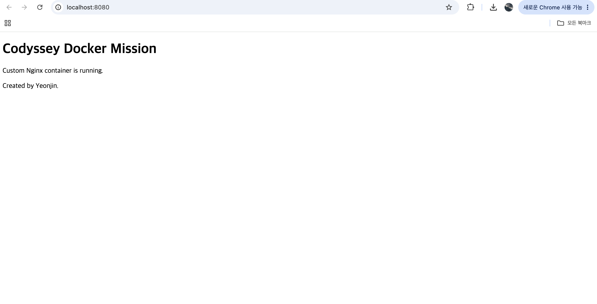
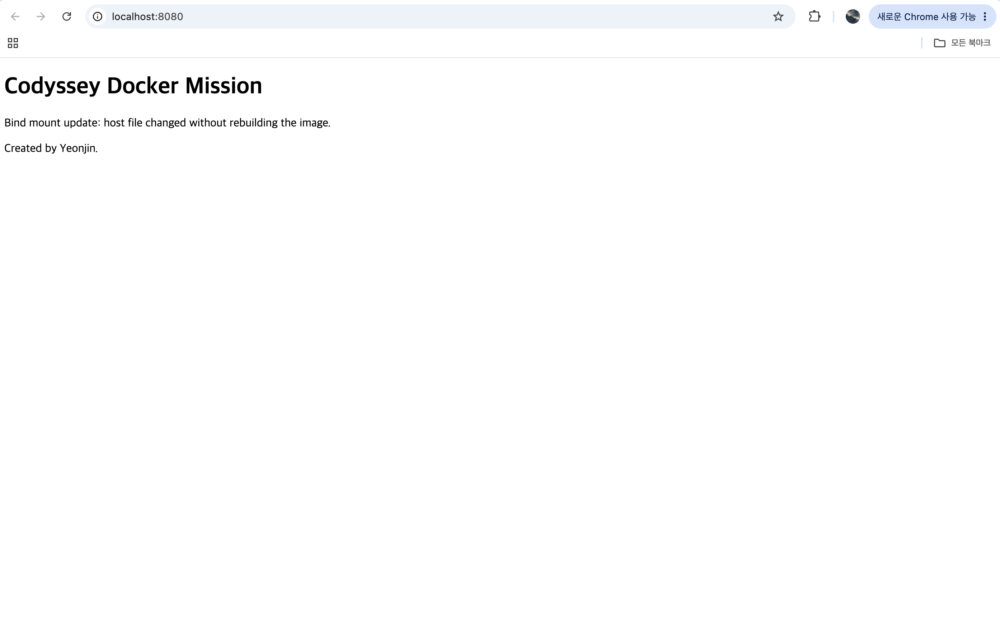
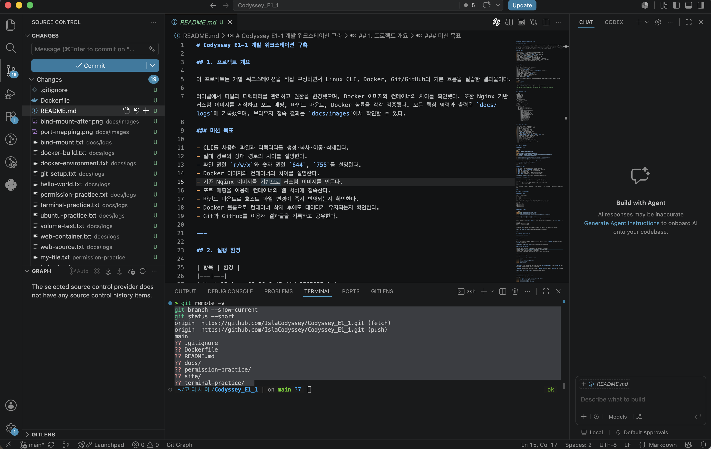

# Codyssey E1-1 개발 워크스테이션 구축

## 1. 프로젝트 개요

이 프로젝트는 개발 워크스테이션을 직접 구성하면서 Linux CLI, Docker, Git/GitHub의 기본 흐름을 실습한 결과물이다.

터미널에서 파일과 디렉터리를 관리하고 권한을 변경했으며, Docker 이미지와 컨테이너의 차이를 확인했다. 또한 Nginx 기반 커스텀 이미지를 제작하고 포트 매핑, 바인드 마운트, Docker 볼륨을 각각 검증했다. 모든 핵심 명령과 출력은 `docs/logs`에 기록했으며, 브라우저 접속 결과는 `docs/images`에서 확인할 수 있다.

### 미션 목표

- CLI를 사용해 파일과 디렉터리를 생성·복사·이동·삭제한다.
- 절대 경로와 상대 경로의 차이를 설명한다.
- 파일 권한 `r/w/x`와 숫자 권한 `644`, `755`를 설명한다.
- Docker 이미지와 컨테이너의 차이를 설명한다.
- 기존 Nginx 이미지를 기반으로 커스텀 이미지를 만든다.
- 포트 매핑을 이용해 컨테이너의 웹 서버에 접속한다.
- 바인드 마운트로 호스트 파일 변경이 즉시 반영되는지 확인한다.
- Docker 볼륨으로 컨테이너 삭제 후에도 데이터가 유지되는지 확인한다.
- Git과 GitHub를 이용해 결과물을 기록하고 공유한다.

---

## 2. 실행 환경

| 항목 | 환경 |
|---|---|
| Host OS | macOS 26.6 (Build 25G5057c) |
| Host architecture | Apple Silicon |
| Shell | zsh (`/bin/zsh`) |
| Docker 실행 환경 | Docker Desktop (`desktop-linux` context) |
| Docker Client/Server | 29.6.2 |
| Docker VM OS | Docker Desktop LinuxKit |
| Container architecture | `aarch64` |
| Docker CPU / Memory | 8 CPUs / 7.75 GiB |
| Git | 2.50.1 (Apple Git-155) |
| 기본 작업 브랜치 | `main` |

Docker 클라이언트와 서버 정보를 함께 확인하여 Docker 엔진이 정상적으로 실행 중임을 검증했다.

```bash
docker --version
docker info
```

- [Docker 환경 전체 로그](./docs/logs/docker-environment.txt)
- [Git 설정 확인 로그](./docs/logs/git-setup.txt)

> 이 실습에서는 OrbStack이 아니라 실제 실행 환경인 Docker Desktop을 사용했다.

---

## 3. 프로젝트 구조

```text
Codyssey_E1_1/
├── README.md
├── Dockerfile
├── .gitignore
├── site/
│   └── index.html
├── terminal-practice/
│   └── original/
│       └── example.txt
├── permission-practice/
│   ├── my-file.txt
│   └── my-directory/
└── docs/
    ├── images/
    │   ├── port-mapping.png
    │   └── bind-mount-after.png
    └── logs/
        ├── docker-environment.txt
        ├── hello-world.txt
        ├── ubuntu-practice.txt
        ├── terminal-practice.txt
        ├── permission-practice.txt
        ├── web-source.txt
        ├── docker-build.txt
        ├── web-container.txt
        ├── bind-mount.txt
        ├── volume-test.txt
        └── git-setup.txt
```

---

## 4. 수행 체크리스트

- [x] 저장소 및 프로젝트 디렉터리 구성
- [x] OS, Shell, Docker, Git 환경 확인
- [x] 터미널 기본 명령 실습
- [x] 절대 경로와 상대 경로 확인
- [x] 파일 및 디렉터리 권한 변경
- [x] Docker Client/Server 동작 확인
- [x] `hello-world` 컨테이너 실행
- [x] Ubuntu 컨테이너 실행 및 내부 명령 수행
- [x] `docker images`, `ps`, `ps -a`, `logs`, `stats` 사용
- [x] Dockerfile 기반 커스텀 Nginx 이미지 제작
- [x] 포트 매핑 및 브라우저 접속 검증
- [x] 바인드 마운트 변경 전·후 검증
- [x] Docker 볼륨 영속성 검증
- [x] Git 사용자 정보와 원격 저장소 확인
- [x] Git 전역 기본 브랜치 `main` 설정 확인
- [x] VS Code GitHub 로그인 및 연동 화면 추가
- [x] 최종 커밋 및 GitHub push

---

## 5. 터미널 기본 조작

### 5.1 수행 명령

```bash
pwd
mkdir -p terminal-practice/original
ls -la
touch terminal-practice/original/example.txt
echo "Codyssey terminal practice" > terminal-practice/original/example.txt
cat terminal-practice/original/example.txt

cp terminal-practice/original/example.txt terminal-practice/copied.txt
mv terminal-practice/copied.txt terminal-practice/renamed.txt
mkdir terminal-practice/moved
mv terminal-practice/renamed.txt terminal-practice/moved/
cat terminal-practice/moved/renamed.txt

rm terminal-practice/moved/renamed.txt
rmdir terminal-practice/moved
```

### 5.2 검증 결과

- `pwd`로 현재 작업 위치가 프로젝트 루트임을 확인했다.
- `ls -la`로 `.git`, `.gitignore` 등 숨김 항목까지 확인했다.
- `touch`와 `echo`로 파일을 만들고 내용을 기록했다.
- `cp`로 파일을 복사했다.
- `mv`로 파일 이름을 변경하고 다른 디렉터리로 이동했다.
- `rm`, `rmdir`로 실습 파일과 빈 디렉터리를 삭제했다.

[터미널 기본 조작 전체 로그](./docs/logs/terminal-practice.txt)

### 5.3 절대 경로와 상대 경로

- **절대 경로**는 파일 시스템의 루트부터 대상을 표현한 전체 경로다.
- **상대 경로**는 현재 작업 디렉터리를 기준으로 대상을 표현한다.

```text
절대 경로: /Users/yeonjin/코디세이/Codyssey_E1_1/site/index.html
상대 경로: ./site/index.html
```

절대 경로는 현재 위치와 관계없이 같은 대상을 가리키지만, 상대 경로는 현재 위치가 달라지면 가리키는 대상도 달라질 수 있다.

---

## 6. 파일 및 디렉터리 권한

### 6.1 권한 의미

| 권한 | 의미 | 숫자 |
|---|---|---:|
| `r` | 읽기 | 4 |
| `w` | 쓰기 | 2 |
| `x` | 실행 또는 디렉터리 접근 | 1 |

권한은 소유자(User), 그룹(Group), 기타 사용자(Others) 순서로 표시된다.

```text
644 = rw-r--r--
755 = rwxr-xr-x
600 = rw-------
700 = rwx------
```

### 6.2 수행 및 결과

```bash
chmod 700 permission-practice/my-directory
chmod 600 permission-practice/my-file.txt
ls -ld permission-practice/my-file.txt permission-practice/my-directory

chmod 755 permission-practice/my-directory
chmod 644 permission-practice/my-file.txt
ls -ld permission-practice/my-file.txt permission-practice/my-directory
```

파일과 디렉터리를 각각 `600`, `700`으로 제한한 뒤 일반적인 파일·디렉터리 권한인 `644`, `755`로 되돌렸다.

```text
디렉터리: drwxr-xr-x = 755
파일:     -rw-r--r-- = 644
```

디렉터리의 `x`는 프로그램 실행이 아니라 디렉터리 내부에 접근할 수 있는 권한을 의미한다.

[권한 변경 전·후 전체 로그](./docs/logs/permission-practice.txt)

---

## 7. Docker 설치 및 기본 점검

### 7.1 Docker 엔진 확인

```bash
docker --version
docker info
```

Docker Client와 Server 정보가 모두 정상 출력됐다. Server Version은 `29.6.2`, 컨테이너 아키텍처는 `aarch64`로 확인됐다.

[Docker 설치 및 데몬 확인 로그](./docs/logs/docker-environment.txt)

### 7.2 이미지와 컨테이너

- **이미지**는 컨테이너를 생성하기 위한 읽기 전용 실행 템플릿이다.
- **컨테이너**는 이미지를 기반으로 만들어진 실제 실행 인스턴스다.
- 하나의 이미지로 여러 컨테이너를 만들 수 있다.
- 컨테이너의 생성·시작·중지·삭제와 이미지의 생명주기는 서로 구분된다.

---

## 8. hello-world 실행

```bash
docker run --name hello-test hello-world
docker images
docker ps
docker ps -a --filter name=hello-test
docker logs hello-test
docker rm hello-test
```

`hello-world` 이미지를 내려받아 컨테이너를 실행했다. `Hello from Docker!` 출력과 `Exited (0)` 상태를 통해 컨테이너가 오류 없이 작업을 완료했음을 확인했다.

`docker ps`에는 실행 중인 컨테이너만 표시됐고, `docker ps -a`에는 종료된 `hello-test`까지 표시됐다.

[hello-world 실행 및 운영 로그](./docs/logs/hello-world.txt)

---

## 9. Ubuntu 컨테이너 실습

### 9.1 컨테이너 실행 및 내부 확인

```bash
docker run -dit --name ubuntu-practice ubuntu:24.04 bash
docker ps --filter name=ubuntu-practice
docker exec ubuntu-practice pwd
docker exec ubuntu-practice ls -la /
docker exec ubuntu-practice cat /etc/os-release
```

컨테이너 내부의 현재 위치는 `/`였고, `.dockerenv`, `/etc`, `/tmp`, `/usr`, `/var` 등 Linux 파일 시스템을 확인했다. `/etc/os-release`에서는 `Ubuntu 24.04.4 LTS`가 확인됐다.

### 9.2 컨테이너 내부 파일 조작

```bash
docker exec ubuntu-practice sh -c \
  'echo "Hello from Ubuntu container" > /tmp/hello.txt'
docker exec ubuntu-practice cat /tmp/hello.txt
docker stats --no-stream ubuntu-practice
```

컨테이너 내부에서 `/tmp/hello.txt`를 만들고 내용을 읽었다. `docker stats --no-stream`으로 CPU, 메모리, 네트워크, 블록 I/O, 프로세스 수를 확인했다.

### 9.3 중지·재시작·삭제

```bash
docker stop ubuntu-practice
docker ps
docker ps -a
docker start ubuntu-practice
docker exec ubuntu-practice cat /tmp/hello.txt
docker rm -f ubuntu-practice
```

같은 컨테이너를 중지한 뒤 재시작했을 때 `/tmp/hello.txt`가 유지됐다. 그러나 이는 같은 컨테이너의 쓰기 계층이 남아 있었기 때문이다. 컨테이너를 삭제한 후에도 데이터를 보존하려면 Docker 볼륨을 사용해야 한다.

### 9.4 `attach`와 `exec`

- `docker attach`는 컨테이너에서 이미 실행 중인 주 프로세스의 입출력에 연결한다.
- `docker exec`는 실행 중인 컨테이너 내부에 새로운 프로세스를 추가로 실행한다.
- 주 프로세스가 셸이라면 `attach` 상태에서 셸을 종료할 때 컨테이너도 종료될 수 있다.
- `exec`로 실행한 셸이나 명령이 끝나도 기존 주 프로세스는 계속 실행된다.

[Ubuntu 컨테이너 전체 실습 로그](./docs/logs/ubuntu-practice.txt)

---

## 10. 커스텀 Nginx 이미지

### 10.1 베이스 이미지 선택

정적 웹 콘텐츠를 제공하기 위해 `nginx:alpine`을 선택했다. Alpine 기반 이미지는 비교적 작고, Nginx의 기본 웹 루트가 제공되므로 정적 웹 서버 실습에 적합하다.

### 10.2 커스텀 포인트

1. 직접 작성한 `site/index.html`을 Nginx 웹 루트에 복사했다.
2. 이미지의 이름과 목적을 OCI Label로 기록했다.
3. 컨테이너가 사용하는 80번 포트를 문서화했다.
4. `HEALTHCHECK`를 추가해 웹 서버 응답 상태를 확인하도록 했다.

### 10.3 Dockerfile

```dockerfile
FROM nginx:alpine

LABEL org.opencontainers.image.title="codyssey-web"
LABEL org.opencontainers.image.description="Codyssey Docker workstation mission"

COPY site/ /usr/share/nginx/html/

EXPOSE 80

HEALTHCHECK --interval=30s --timeout=3s \
  CMD wget -q --spider http://localhost/ || exit 1
```

- [Dockerfile](./Dockerfile)
- [웹 페이지 소스](./site/index.html)
- [초기 웹 소스 확인 로그](./docs/logs/web-source.txt)

### 10.4 빌드

```bash
docker build -t codyssey-web:1.0 .
docker images codyssey-web
```

`codyssey-web:1.0` 이미지가 정상 생성되고 로컬 이미지 목록에 등록됐다.

[Docker 이미지 빌드 전체 로그](./docs/logs/docker-build.txt)

---

## 11. 포트 매핑과 웹 접속

### 11.1 실행 및 검증

```bash
docker run -d \
  --name codyssey-web \
  -p 8080:80 \
  codyssey-web:1.0

docker ps --filter name=codyssey-web
docker logs codyssey-web
curl http://localhost:8080
docker stats --no-stream codyssey-web
```

`-p 8080:80`의 의미는 다음과 같다.

```text
호스트의 8080 포트 → 컨테이너의 80 포트
```

컨테이너는 호스트와 네트워크가 격리되어 있으므로, 호스트 브라우저에서 컨테이너의 Nginx로 접근하려면 포트 매핑이 필요하다.

`curl`에서 직접 작성한 HTML이 반환됐고, 브라우저에서도 `localhost:8080` 접속에 성공했다.

[웹 컨테이너 실행·로그·접속·리소스 로그](./docs/logs/web-container.txt)

### 11.2 브라우저 접속 증거



주소창의 `localhost:8080`과 직접 작성한 웹 페이지가 함께 표시된다.

---

## 12. 바인드 마운트 검증

### 12.1 실행

```bash
docker run -d \
  --name codyssey-bind \
  -p 8080:80 \
  --mount type=bind,source="$(pwd)/site",target=/usr/share/nginx/html,readonly \
  nginx:alpine
```

호스트의 `site` 디렉터리를 컨테이너의 `/usr/share/nginx/html`에 읽기 전용으로 연결했다.

### 12.2 변경 전·후

변경 전:

```html
<p>Custom Nginx container is running.</p>
```

호스트의 `site/index.html`만 변경했다.

변경 후:

```html
<p>Bind mount update: host file changed without rebuilding the image.</p>
```

Docker 이미지를 다시 빌드하거나 컨테이너를 다시 시작하지 않았지만 `curl`과 브라우저에 변경된 내용이 반영됐다. 바인드 마운트는 호스트의 실제 파일을 컨테이너에 연결하기 때문이다.

[바인드 마운트 변경 전·후 및 진단 로그](./docs/logs/bind-mount.txt)



---

## 13. Docker 볼륨 영속성

### 13.1 볼륨 생성 및 첫 번째 컨테이너

```bash
docker volume create codyssey-data

docker run -d \
  --name volume-test-1 \
  -v codyssey-data:/data \
  ubuntu:24.04 \
  sleep infinity

docker exec volume-test-1 \
  sh -c 'echo "persistent codyssey data" > /data/result.txt'
docker exec volume-test-1 cat /data/result.txt
```

첫 번째 컨테이너의 `/data`에 `result.txt`를 생성한 후 컨테이너를 삭제했다.

```bash
docker rm -f volume-test-1
docker volume ls --filter name=codyssey-data
```

### 13.2 두 번째 컨테이너에서 데이터 확인

```bash
docker run -d \
  --name volume-test-2 \
  -v codyssey-data:/data \
  ubuntu:24.04 \
  sleep infinity

docker exec volume-test-2 cat /data/result.txt
```

결과:

```text
persistent codyssey data
```

첫 번째 컨테이너는 삭제됐지만 `codyssey-data` 볼륨은 독립적으로 유지됐다. 두 번째 컨테이너에 같은 볼륨을 연결했을 때 기존 파일을 다시 읽을 수 있었으므로 데이터 영속성이 검증됐다.

[Docker 볼륨 생성·삭제 전후·영속성 전체 로그](./docs/logs/volume-test.txt)

### 13.3 바인드 마운트와 볼륨 비교

| 구분 | 바인드 마운트 | Docker 볼륨 |
|---|---|---|
| 저장 위치 | 사용자가 지정한 호스트 경로 | Docker가 관리하는 영역 |
| 주요 목적 | 개발 중 소스 변경 즉시 반영 | 컨테이너와 분리된 데이터 영속성 |
| 경로 의존성 | 호스트 경로에 의존 | Docker가 관리하여 상대적으로 낮음 |
| 대표 사례 | 웹 소스, 설정 파일 연결 | 데이터베이스, 서비스 데이터 |

---

## 14. Git과 GitHub 연동

### 14.1 역할 차이

- **Git**은 로컬에서 파일 변경 이력, 브랜치, 커밋을 관리하는 분산 버전 관리 도구다.
- **GitHub**는 Git 저장소를 원격으로 보관하고 코드 리뷰, Pull Request, Issue 등 협업 기능을 제공하는 플랫폼이다.

### 14.2 확인 결과

```bash
git --version
git config --global --get user.name
git config --global --get user.email
git branch --show-current
git remote -v
```

- Git 사용자 이름과 이메일 설정 확인
- 현재 브랜치 `main` 확인
- 원격 저장소 `https://github.com/IslaCodyssey/Codyssey_E1_1.git` 확인

[Git 설정 및 원격 저장소 로그](./docs/logs/git-setup.txt)

### 14.3 기본 브랜치 및 VS Code 연동

Git 전역 기본 브랜치를 `main`으로 설정하고 결과를 확인했다.

```bash
git config --global init.defaultBranch main
git config --global --get init.defaultBranch
```

```text
main
```

VS Code에서 프로젝트를 열고 Source Control의 변경 파일, 현재 `main` 브랜치, GitHub 원격 저장소 주소를 확인했다. 인증 토큰, 비밀번호, 인증 코드와 개인 이메일은 캡처에서 제외했다.



---

## 15. 트러블슈팅

### 15.1 Ubuntu 컨테이너 중지 후 `Exited (137)`

**문제**

```text
ubuntu-practice   Exited (137)
```

**원인 가설**

`docker stop`은 먼저 주 프로세스에 정상 종료 신호를 보내고 대기한다. 주 프로세스인 `bash`가 제한 시간 내에 종료되지 않아 강제 종료됐을 가능성을 생각했다.

**확인**

```bash
docker ps -a --filter name=ubuntu-practice
```

`Exited (137)`을 확인했다. 종료 코드 137은 일반적으로 `128 + 9`, 즉 `SIGKILL`에 의한 종료를 의미한다.

**해결 및 대안**

컨테이너를 다시 시작해 정상 동작과 기존 파일을 확인한 뒤 실습 종료 시 `docker rm -f`로 명시적으로 정리했다. 실제 서비스에서는 애플리케이션이 종료 신호를 적절히 처리하도록 구성해야 한다.

**결과**

재시작 후 컨테이너가 `Up` 상태가 됐고 `/tmp/hello.txt`도 다시 확인됐다.

[관련 로그](./docs/logs/ubuntu-practice.txt)

### 15.2 바인드 마운트 파일 변경 직후 404

**문제**

호스트의 `site/index.html`을 수정한 직후 `curl http://localhost:8080`에서 일시적으로 `404 Not Found`가 반환됐다.

**원인 가설**

바인드 마운트 경로 오류, 파일 권한 문제 또는 컨테이너 내부에서 `index.html`을 찾지 못하는 문제를 의심했다.

**확인**

```bash
docker inspect codyssey-bind \
  --format '{{range .Mounts}}{{.Source}} -> {{.Destination}} RW={{.RW}}{{println}}{{end}}'
docker exec codyssey-bind ls -la /usr/share/nginx/html
docker exec codyssey-bind cat /usr/share/nginx/html/index.html
docker logs codyssey-bind
```

- 마운트 경로가 올바르게 연결됨
- `RW=false`로 읽기 전용 설정 확인
- 컨테이너 내부에 변경된 `index.html`이 존재함
- Nginx 로그에서 변경 시점에만 `No such file or directory` 발생

**원인**

macOS의 `sed -i`가 임시 파일 생성 후 기존 파일을 교체하는 과정에서 Docker Desktop의 파일 동기화가 해당 파일을 짧은 순간 찾지 못한 것으로 판단했다.

**해결**

마운트 경로, 파일 존재 여부, 파일 내용과 Nginx 로그를 확인한 뒤 요청을 다시 실행했다.

**결과**

이미지 재빌드 및 컨테이너 재시작 없이 변경된 HTML이 정상적으로 반환됐다.

[관련 로그](./docs/logs/bind-mount.txt)

---

## 16. 재현 방법

### 16.1 저장소 복제

```bash
git clone https://github.com/IslaCodyssey/Codyssey_E1_1.git
cd Codyssey_E1_1
```

### 16.2 이미지 빌드

```bash
docker build -t codyssey-web:1.0 .
```

### 16.3 컨테이너 실행

```bash
docker run -d \
  --name codyssey-web \
  -p 8080:80 \
  codyssey-web:1.0
```

### 16.4 접속 확인

```bash
curl http://localhost:8080
```

브라우저:

```text
http://localhost:8080
```

### 16.5 정리

```bash
docker rm -f codyssey-web
```

호스트에서 8080 포트를 이미 사용 중이면 `-p 8081:80`처럼 호스트 포트만 변경할 수 있다.

---

## 17. 보안 및 개인정보 보호

- 토큰, 비밀번호, 개인키, 인증 코드는 저장소에 기록하지 않는다.
- `.env`, `*.pem`, `*.key`는 `.gitignore`에서 제외한다.
- 인증 화면을 캡처할 때 민감정보가 보이지 않는지 확인한다.
- 민감정보가 Git 기록에 포함되면 파일만 삭제하지 않고 히스토리에서도 제거한 뒤 해당 인증정보를 재발급한다.

---

## 18. 결과 요약

이 실습을 통해 터미널 기반 파일 관리와 권한 변경, Docker 이미지 빌드와 컨테이너 운영, 포트 매핑, 바인드 마운트, 볼륨 영속성을 직접 검증했다.

특히 이미지와 컨테이너가 서로 다른 생명주기를 가지며, 컨테이너의 격리된 네트워크를 호스트와 연결하려면 포트 매핑이 필요하다는 점을 확인했다. 또한 개발 중 소스 연결에는 바인드 마운트가, 컨테이너 삭제 후에도 유지해야 하는 데이터에는 Docker 볼륨이 적합하다는 차이를 실행 결과로 확인했다.
