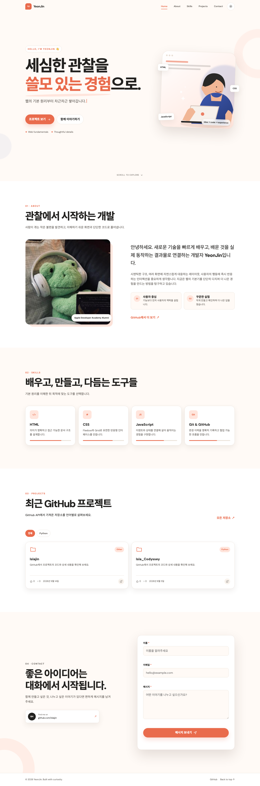
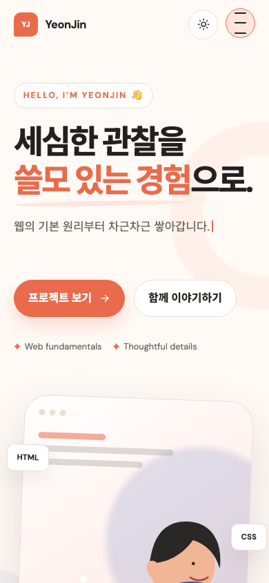

# YeonJin Portfolio

순수 HTML, CSS, JavaScript로 만든 반응형 자기소개 포트폴리오입니다. 프레임워크 없이 **사용자 이벤트 → 상태 변경 → DOM 업데이트** 흐름을 직접 구현했고, GitHub REST API에서 `Islajin` 계정의 공개 저장소를 불러옵니다.

## 배포 주소

- GitHub Pages: <https://islajin.github.io/Isla_Codyssey/>
- GitHub 저장소: <https://github.com/Islajin/Isla_Codyssey/tree/B1_1>

> Pages 배포 직후에는 사이트가 열리기까지 1~3분 정도 걸릴 수 있습니다.

## 화면 미리보기

| 데스크톱 | 모바일 | 다크 모드 |
| --- | --- | --- |
|  |  |  |

## 구현 기능

### 1. 시맨틱 HTML과 접근성

- `header`, `nav`, `main`, `section`, `article`, `footer`로 콘텐츠의 역할을 구분했습니다.
- 네비게이션 링크는 각 섹션의 `id`와 연결되어 있습니다.
- 의미가 있는 이미지에는 설명 가능한 `alt`를, 장식 이미지는 빈 `alt`와 `aria-hidden`을 사용했습니다.
- 폼의 `label[for]`와 입력 요소의 `id`를 일치시켰습니다.
- 키보드 사용자를 위한 본문 바로가기 링크, 버튼 상태를 알리는 `aria-expanded`, 동적 메시지를 읽는 `aria-live`를 넣었습니다.

시맨틱 태그는 단순히 모양을 만드는 것이 아니라 브라우저, 검색 엔진, 스크린 리더에 “이 영역이 어떤 역할인지” 알려줍니다. 이 프로젝트에서는 화면의 기능 단위를 기준으로 태그를 선택했습니다.

### 2. 반응형 레이아웃

- 모바일 화면을 기본으로 작성한 뒤 `768px`, `1024px` 미디어 쿼리에서 레이아웃을 확장했습니다.
- 네비게이션은 한 축에서 항목을 정렬하는 문제라서 **Flexbox**를 사용했습니다.
- 스킬/프로젝트 목록은 행과 열로 카드가 반복되는 문제라서 **Grid**를 사용했습니다.
- 프로젝트 카드는 `repeat(auto-fit, minmax(290px, 1fr))`로 화면 너비에 맞춰 열 개수가 자동으로 바뀝니다.
- 768px 미만에서는 메뉴를 숨기고 햄버거 버튼을 표시합니다.

Flexbox는 행 또는 열처럼 **한 방향 정렬**에 강하고, Grid는 행과 열을 동시에 다루는 **두 방향 배치**에 적합합니다. 그래서 메뉴에는 Flexbox, 카드 목록에는 Grid를 선택했습니다.

### 3. 다크 모드와 상태 유지

다크 모드의 흐름은 다음과 같습니다.

```text
토글 click → pageState.theme 변경 → html[data-theme] 변경 → CSS 변수 교체
                                              ↓
                                      localStorage에 저장
```

- 최초 방문이고 저장된 값이 없으면 `prefers-color-scheme`으로 시스템 테마를 감지합니다.
- 사용자가 버튼을 누르면 `light`/`dark` 상태를 바꾸고 `localStorage`에 저장합니다.
- 새로고침하면 저장값을 먼저 읽으므로 사용자가 고른 테마가 유지됩니다.
- 시스템 테마가 바뀔 때 저장된 사용자 선택이 없다면 화면도 함께 바뀝니다.

### 4. 햄버거 메뉴와 스크롤 인터랙션

- 햄버거 버튼 `click` → `pageState.menuOpen` 변경 → 메뉴와 버튼에 `active` 클래스 토글
- 메뉴 링크 `click` → `preventDefault()` → 대상 요소를 `scrollIntoView()`로 부드럽게 이동
- 스크롤 **60px 이상** → 헤더에 `scrolled` 클래스 추가
- 스크롤 **300px 이상** → 맨 위로 이동 버튼에 `visible` 클래스 추가
- 현재 보고 있는 섹션에 해당하는 메뉴 링크를 활성화합니다.

HTML의 `onclick` 속성은 사용하지 않았습니다. `querySelector`/`querySelectorAll`로 DOM을 선택하고 `addEventListener`로 `click`, `submit`, `scroll`, `input` 이벤트를 연결했습니다.

### 5. 스크롤 등장 애니메이션

`IntersectionObserver`가 `.reveal` 요소를 관찰합니다. 요소의 **20%(`threshold: 0.2`)**가 화면 안에 들어오면 `visible` 클래스를 추가하고 관찰을 종료합니다. 매 스크롤마다 모든 위치를 계산하는 방식보다 효율적입니다.

사용자가 운영체제에서 “동작 줄이기”를 켰다면 `prefers-reduced-motion`을 감지해 애니메이션을 사실상 제거합니다.

### 6. GitHub API와 프로젝트 상태 UI

호출 주소:

```text
https://api.github.com/users/Islajin/repos?sort=updated&per_page=100
```

처리 흐름:

```text
fetchProjects() 실행
  ├─ status = loading → 스피너 렌더링
  ├─ 응답 성공 → fork/보관 저장소 제외 → status = success → 카드 렌더링
  ├─ 결과 0개 → 빈 상태 메시지 렌더링
  └─ 요청 실패 → status = error → 오류 메시지 + 다시 시도 버튼 렌더링
```

- `fetch`와 `async/await`, `try/catch`로 비동기 요청과 예외를 처리합니다.
- `403` 또는 `429` 응답은 GitHub API 요청 한도 오류로 구분해 안내합니다.
- 인증 없는 GitHub API는 시간당 60회 제한이 있어 정상 응답을 `localStorage`에 **10분 동안 캐시**합니다.
- 객체 **구조분해 할당**으로 저장소 속성을 꺼냅니다.
- `filter()`로 fork/보관 저장소와 선택 언어를 거릅니다.
- `map()`과 **템플릿 리터럴**로 저장소 데이터를 카드 HTML로 바꿉니다.
- `forEach()`로 DOM 목록을 순회하며 이벤트와 클래스를 처리합니다.
- API 문자열은 `escapeHtml()`을 거친 뒤 `innerHTML`에 넣어 예기치 않은 마크업 실행을 막습니다.

### 7. 프로젝트 언어 필터 (보너스)

API 결과에서 언어 목록을 `Set`으로 추출합니다. 필터 버튼을 누르면 다음 흐름이 실행됩니다.

```text
필터 click → selectedLanguage 변경 → filter() 실행 → 프로젝트 카드 다시 렌더링
```

필터는 API 응답에 실제 존재하는 언어만 동적으로 만듭니다.

### 8. 폼 유효성 검사

- 이름, 이메일, 메시지를 모두 필수값으로 검사합니다.
- 정규식으로 이메일 형식을 확인합니다.
- 메시지는 의미 있는 문의가 되도록 10자 이상인지 확인합니다.
- `input` 이벤트마다 해당 필드의 상태를 갱신해 입력 요소 가까이에 오류를 표시합니다.
- `submit` 이벤트에서는 `event.preventDefault()`로 기본 새로고침을 막고 전체 필드를 다시 검사합니다.
- 오류가 있으면 첫 번째 오류 필드로 포커스를 이동합니다.

폼의 흐름은 `입력 이벤트 → values/errors 상태 변경 → 필드 클래스와 오류 textContent 변경`입니다.

### 9. 문의 전송 (보너스)

현재 공개 프로필에는 수신 이메일이 없으므로 개인정보를 임의로 코드에 넣지 않았습니다. 기본 상태에서는 유효성 검사를 통과한 내용을 `mailto:` 형식으로 변환해 사용자의 메일 앱에 준비합니다.

Formspree 실제 자동 전송을 활성화하려면 [js/main.js](js/main.js) 상단의 값을 본인의 Formspree 엔드포인트로 바꿉니다.

```js
const FORM_ENDPOINT = "https://formspree.io/f/본인의_FORM_ID";
```

값이 있으면 같은 제출 함수가 `fetch(POST)`로 Formspree에 전송하고, 값이 비어 있으면 메일 앱 방식을 사용합니다. Formspree ID는 공개 프런트엔드 식별자이지만, 서비스를 받을 이메일은 Formspree 대시보드에서 직접 등록·인증해야 합니다.

### 10. 타이핑 효과 (보너스)

Hero 문장을 문자열 배열로 관리합니다. `sentenceIndex`, `characterIndex`, `deleting` 상태에 따라 문장을 한 글자씩 쓰고 지운 뒤 다음 문장으로 넘어갑니다. 운영체제의 “동작 줄이기” 설정이 켜져 있으면 첫 문장만 바로 보여 줍니다.

## 상태 → 렌더링 구조

전역 `pageState`는 화면에서 변할 수 있는 값을 한곳에 모읍니다.

| 상태 | 사용자/외부 이벤트 | 상태 변경 | DOM 업데이트 |
| --- | --- | --- | --- |
| 테마 | 토글 클릭 | `pageState.theme` | `data-theme`, 버튼 설명 |
| 모바일 메뉴 | 햄버거 클릭 | `pageState.menuOpen` | `active` 클래스, `aria-expanded` |
| 프로젝트 | API 응답/재시도 | `status`, `items`, `error` | 로딩·성공·오류·빈 UI |
| 필터 | 언어 버튼 클릭 | `selectedLanguage` | 필터 버튼과 카드 목록 |
| 폼 | 입력/제출 | `values`, `errors`, `status` | 오류·성공 메시지 |

이 구조는 React의 “상태가 바뀌면 UI를 다시 계산한다”는 사고방식의 기초입니다. 차이는 React가 DOM 변경을 대신 처리하지만 이 프로젝트에서는 렌더 함수를 직접 작성했다는 점입니다.

## 프로젝트 구조

```text
.
├── index.html
├── css/
│   └── style.css
├── js/
│   └── main.js
├── images/
│   ├── favicon.svg
│   └── profile-illustration.svg
├── docs/
│   └── screenshots/
│       ├── desktop.png
│       ├── mobile.png
│       └── dark.png
└── README.md
```

## 실행 방법

별도 설치나 빌드 과정이 없습니다.

1. 저장소를 복제하고 `B1_1` 브랜치로 이동합니다.
2. VS Code에서 프로젝트 폴더를 엽니다.
3. `index.html`을 Live Server로 실행합니다.

또는 터미널에서 다음과 같이 실행합니다.

```bash
python3 -m http.server 8080
```

브라우저에서 <http://localhost:8080>으로 접속합니다. `file://`로 직접 열어도 대부분 동작하지만 로컬 서버 사용이 실제 배포 환경과 더 비슷합니다.

## 사용 기술

- HTML5: 시맨틱 마크업, 접근성 속성, 폼
- CSS3: CSS 변수, Flexbox, Grid, 미디어 쿼리, transition/keyframes
- JavaScript ES6+: DOM API, 이벤트, 상태 객체, 구조분해 할당, 배열 메서드
- Web APIs: Fetch, Local Storage, Intersection Observer, Match Media
- GitHub REST API / GitHub Pages

외부 UI 프레임워크나 JavaScript 라이브러리는 사용하지 않았습니다. Google Fonts만 허용 범위 안에서 사용했고, 아이콘과 일러스트는 직접 작성한 SVG입니다.

## 발표할 때 설명할 핵심

1. **왜 시맨틱 태그를 썼나?** 화면의 모양이 아니라 각 영역의 의미를 브라우저와 보조 기술에 전달하기 위해서다.
2. **왜 메뉴는 Flex, 카드는 Grid인가?** 메뉴는 한 방향 정렬, 카드는 행·열이 함께 바뀌는 반복 배치이기 때문이다.
3. **DOM 이벤트는 어떻게 연결했나?** `querySelector`로 요소를 찾고 `addEventListener`에서 상태를 바꾼 뒤 렌더 함수가 클래스나 내용을 갱신한다.
4. **GitHub API 상태를 어떻게 표현했나?** 요청 전 loading, 응답 후 success, 예외 시 error로 상태를 나누고 각 상태에 맞는 UI를 렌더링했다.
5. **왜 localStorage를 썼나?** 새로고침으로 메모리 상태가 사라져도 사용자의 테마 선택을 복원하고, API 반복 호출을 줄이기 위해서다.
6. **React와 어떤 관련이 있나?** 이벤트가 상태를 바꾸고 상태에 따라 UI가 달라지는 원리는 같으며, 여기서는 그 DOM 업데이트를 직접 작성했다.

## 요구사항 체크리스트

- [x] Hero, About, Skills, Projects, Contact, Footer
- [x] 시맨틱 태그와 `label` 연결, 이미지 `alt`
- [x] 외부 CSS/JavaScript와 `defer`
- [x] CSS 변수, 다크 모드 변수
- [x] Flexbox 네비게이션, Grid 프로젝트 카드
- [x] 모바일 퍼스트, 768px/1024px 반응형
- [x] 햄버거 메뉴, 부드러운 스크롤
- [x] 60px 헤더 변화, 300px 스크롤 탑 버튼
- [x] 다크 모드 저장과 시스템 테마 감지
- [x] Intersection Observer 스크롤 애니메이션 (`threshold: 0.2`)
- [x] 폼 필수값/이메일/메시지 길이 검사
- [x] GitHub API 로딩/성공/오류/빈 상태와 재시도
- [x] `const`/`let`, 화살표 함수, 구조분해, `map`/`filter`/`forEach`
- [x] 프로젝트 언어 필터 보너스
- [x] Hero 타이핑 효과 보너스
- [x] 문의 메일 앱 전송 + Formspree 연동 지점
- [x] 시스템 다크 모드 보너스

## API 사용 시 참고

인증하지 않은 GitHub API는 IP 기준 시간당 60회로 제한됩니다. 제한에 도달하면 프로젝트 영역에 안내와 재시도 버튼이 표시됩니다. 테스트 중에는 개발자 도구의 Application → Local Storage에서 `yeonjin-github-projects` 값을 지우면 캐시 없는 최초 요청을 다시 확인할 수 있습니다.
